# Lab 01 - Identity and Access Management (IAM) Report


### 1. Aim / Objective

The objective of this practical exercise was to set up a durable local AWS emulation environment using Floci and Docker Compose, configure the AWS CLI, and build an IAM foundation for the USMS project. The lab focused on creating IAM users, groups, customer managed policies, inline policies, roles, trust policies, an EC2 instance profile, and temporary credentials using AWS STS.

By the end of the practical, the required IAM resources were created and verified using CLI commands, and the generated ARNs were saved in `configs/lab-01.env` for use in future labs.

### 2. Introduction

AWS Identity and Access Management (IAM) is a security service used to manage access to AWS resources. It allows cloud administrators to create users, organize users into groups, define permissions using JSON policy documents, and assign roles to services or people. Key IAM features include fine-grained access control, policy-based authorization, role assumption, temporary credentials through STS, and support for least-privilege security design. IAM is important in cloud computing because it protects cloud resources from unauthorized access and provides a controlled way to manage human and application permissions. Common applications include employee access management, workload permissions for EC2 and Lambda, secure cross-account access, and separation of duties in enterprise environments.

### 3. Use Case

- Managing administrator, developer, and auditor identities in a cloud project.
- Assigning permissions to teams through IAM groups instead of attaching policies directly to every user.
- Granting EC2 and Lambda workloads permissions through IAM roles instead of storing long-term credentials in applications.
- Allowing developers to temporarily assume a higher-privilege role for infrastructure tasks.
- Applying least-privilege access control to protect student data and application resources in the USMS project.

---

### 4. System Architecture / Design *(If Applicable)*

The lab used a local AWS-compatible environment. AWS CLI requests were sent to the Floci endpoint running on `localhost:4566`, and IAM/STS resources were created inside the local account `000000000000`.

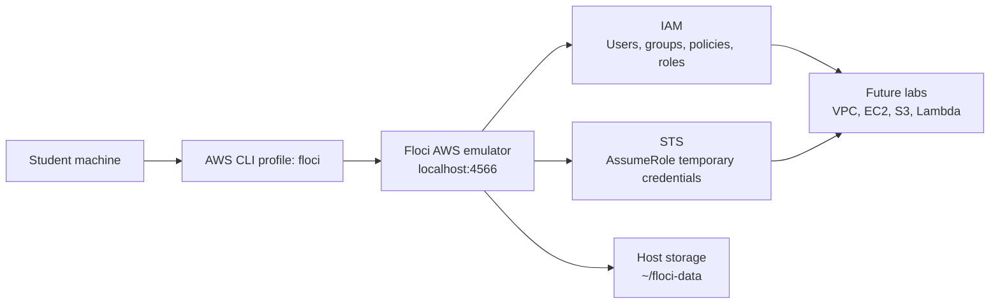

Resource relationship summary:

- `usms-admin-01` belongs to `usms-admins`.
- `usms-dev-01` belongs to `usms-developers`.
- `usms-audit-01` belongs to `usms-auditors`.
- `usms-ec2-app-role` is trusted by `ec2.amazonaws.com` and is wrapped by `usms-ec2-app-profile`.
- `usms-lambda-exec-role` is trusted by `lambda.amazonaws.com`.
- `usms-developer-role` can be assumed temporarily by the developer identity using STS.


### 5. Implementation Procedure

1. Created the course workspace structure with folders for `configs`, `policies`, `scripts`, `outputs`, and lab documentation.
2. Configured `.gitignore` before generating secrets so output files such as access keys would not be committed.
3. Created `configs/course.env` with shared values such as the Floci endpoint, account ID, storage mode, AWS profile, and region.
4. Started Floci using Docker Compose with durable host storage mounted at `~/floci-data`.
5. Installed and configured AWS CLI v2 with the `floci` profile pointing to `http://localhost:4566`.
6. Verified that CLI commands reached Floci by running `aws sts get-caller-identity`.
7. Confirmed that the environment was isolated from real AWS and that resources persisted after restart.
8. Inspected the empty IAM account before creating resources.
9. Created IAM groups: `usms-admins`, `usms-developers`, and `usms-auditors`.
10. Created IAM users: `usms-admin-01`, `usms-dev-01`, and `usms-audit-01`.
11. Added each user to the appropriate group.
12. Explored AWS managed policies and attached read-only access for the auditor use case.
13. Created customer managed policies including `USMSDeveloperBase`, `USMSStudentDataReadWrite`, `USMSAssumeAppRoles`, and `USMSLambdaBasic`.
14. Added the inline policy `USMSSelfManageCredentials` to `usms-dev-01` for self-service credential management.
15. Inspected the created users, groups, policies, and attachments as required in Step 26.
16. Created a new version of `USMSDeveloperBase` and set version `v2` as the default policy version.
17. Created `usms-ec2-app-role` using the EC2 trust policy and attached the student-data policy.
18. Created `usms-ec2-app-profile` and added the EC2 role to the instance profile.
19. Created `usms-lambda-exec-role` using the Lambda trust policy and attached the Lambda basic policy.
20. Created `usms-developer-role` for human role assumption and tested temporary credentials using STS.
21. Created an access key for `usms-dev-01` and stored it in `outputs/usms-dev-01-access-key.json`.
22. Generated `configs/lab-01.env` containing non-secret ARNs and names required by later labs.
23. Captured output files such as `outputs/assumed-role.json` and reviewed the final lab state.

### 6. Results and Evidence

#### 6.1 CLI / SDK Output

The lab was completed through AWS CLI commands against the local Floci endpoint. Add each screenshot directly below the matching command block. Use the filenames shown so the report remains easy to follow.

Before taking screenshots, open the terminal in the course folder and load the lab environment:

```bash
cd ~/aws-floci-course
source configs/course.env
./scripts/setup/floci-up.sh
```

**Screenshot 1: AWS CLI and Floci identity verification**

This screenshot verifies that the AWS CLI is connected to the local Floci account.

```bash
aws sts get-caller-identity --profile floci
./scripts/utilities/whoami.sh
```

Expected evidence: the account should show `000000000000`, confirming that requests are reaching the local Floci account.

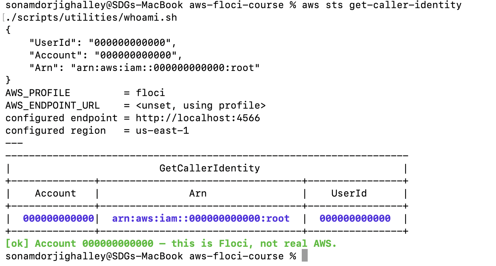

**Screenshot 2: IAM users created**

This screenshot verifies that the IAM users were created.

```bash
aws iam list-users \
  --query 'Users[*].{User:UserName,Created:CreateDate,Arn:Arn}' \
  --output table

aws iam get-user --user-name usms-dev-01
aws iam list-user-tags --user-name usms-dev-01 --output table
```

Expected evidence: the users `usms-admin-01`, `usms-dev-01`, and `usms-audit-01` should appear.

Add screenshot here:

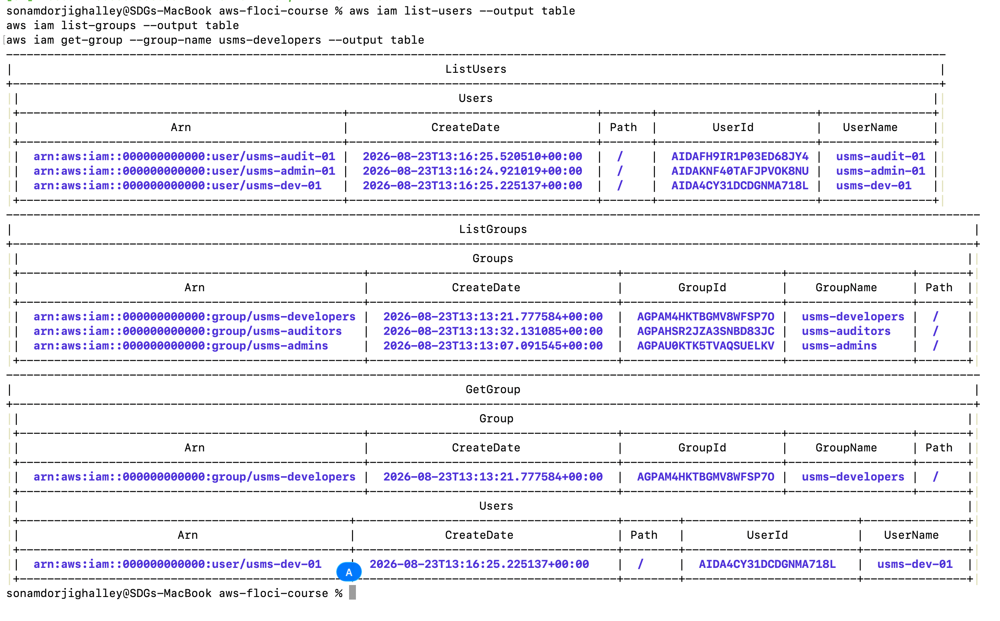

**Screenshot 3: IAM groups and membership**

This screenshot verifies that IAM groups exist and that `usms-dev-01` belongs to `usms-developers`.

```bash
aws iam list-groups --query 'Groups[*].[GroupName,Arn]' --output table

aws iam get-group --group-name usms-developers \
  --query 'Users[*].UserName' --output text

aws iam list-groups-for-user --user-name usms-dev-01 \
  --query 'Groups[*].GroupName' --output text
```

Expected evidence: `usms-admins`, `usms-developers`, and `usms-auditors` should appear, and `usms-dev-01` should be shown as a developer group member.


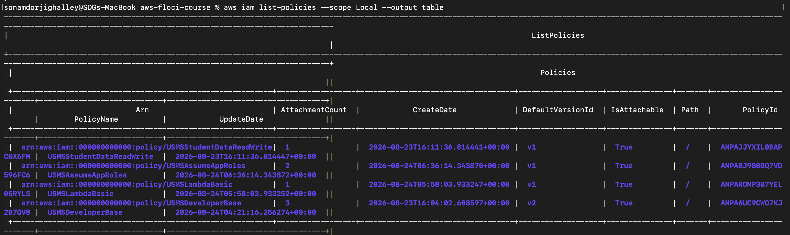

**Screenshot 4: Group policy attachments**

This screenshot verifies the policies attached to the auditor and developer groups.

```bash
aws iam list-attached-group-policies --group-name usms-auditors --output table

aws iam list-attached-group-policies --group-name usms-developers --output table
```

Expected evidence: the auditor group should have read-only access, and the developer group should show developer-related policies.

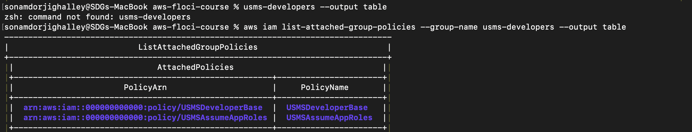

**Screenshot 5: Inline policy on developer user**

This screenshot verifies the inline self-management policy attached to `usms-dev-01`.

```bash
aws iam list-user-policies --user-name usms-dev-01
aws iam get-user-policy --user-name usms-dev-01 --policy-name USMSSelfManageCredentials
```

Expected evidence: `USMSSelfManageCredentials` should be listed and its policy document should be displayed.


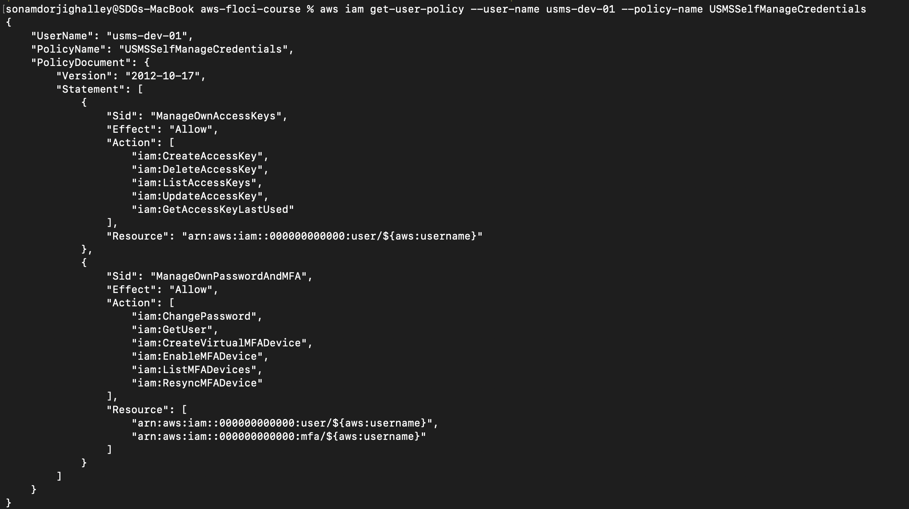

**Screenshot 6: Step 26 IAM user inspection**

This screenshot is from Step 26 of the practical and inspects what was built for the developer user.

```bash
IAM_USER=usms-dev-01
echo "=== groups ===";      aws iam list-groups-for-user       --user-name $IAM_USER --query 'Groups[*].GroupName'                --output text
echo "=== attached ===";    aws iam list-attached-user-policies --user-name $IAM_USER --query 'AttachedPolicies[*].PolicyName'    --output text
echo "=== inline ===";      aws iam list-user-policies          --user-name $IAM_USER --query 'PolicyNames'                       --output text
echo "=== access keys ==="; aws iam list-access-keys            --user-name $IAM_USER --query 'AccessKeyMetadata[*].AccessKeyId'  --output text
```

Expected evidence: the output should show the developer group, inline policy name, and access key information for `usms-dev-01`.


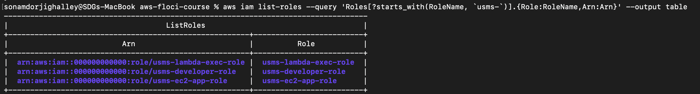

**Screenshot 7: Managed policy version verification**

This screenshot verifies that `USMSDeveloperBase` was versioned and that the default version is set correctly.

```bash
aws iam list-policy-versions \
  --policy-arn arn:aws:iam::000000000000:policy/USMSDeveloperBase \
  --query 'Versions[*].{Version:VersionId,Default:IsDefaultVersion,Created:CreateDate}' \
  --output table
```

Expected evidence: policy version `v2` should be visible and marked as the default version.


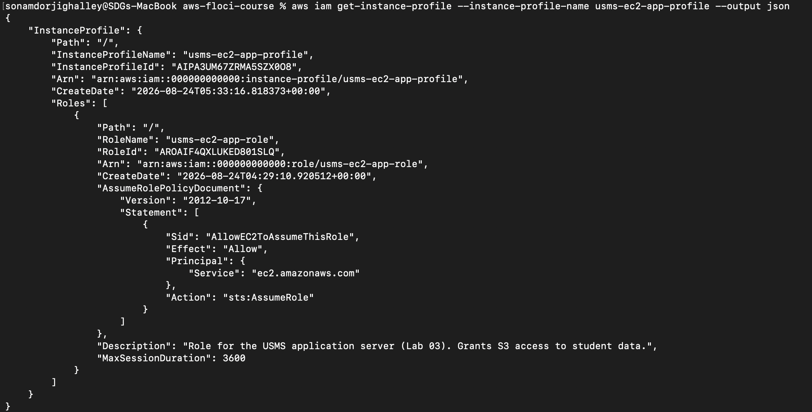

**Screenshot 8: EC2 role and instance profile**

This screenshot verifies the EC2 application role, attached role policies, and instance profile.

```bash
aws iam get-role --role-name usms-ec2-app-role \
  --query 'Role.{Name:RoleName,Arn:Arn,Trust:AssumeRolePolicyDocument.Statement[0].Principal}' \
  --output json

aws iam list-attached-role-policies --role-name usms-ec2-app-role --output table

aws iam get-instance-profile --instance-profile-name usms-ec2-app-profile \
  --query 'InstanceProfile.{Profile:InstanceProfileName,Roles:Roles[*].RoleName}' \
  --output json
```

Expected evidence: `usms-ec2-app-role` should exist, the correct policy should be attached, and the role should appear inside `usms-ec2-app-profile`.


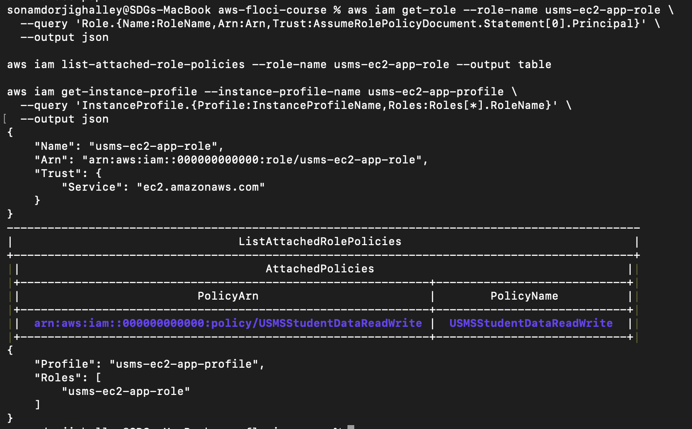

**Screenshot 9: All USMS roles**

This screenshot verifies all IAM roles created for the USMS project.

```bash
aws iam list-roles \
  --query 'Roles[?starts_with(RoleName, `usms-`)].{Role:RoleName,Arn:Arn}' \
  --output table
```

Expected evidence: `usms-ec2-app-role`, `usms-lambda-exec-role`, and `usms-developer-role` should appear.


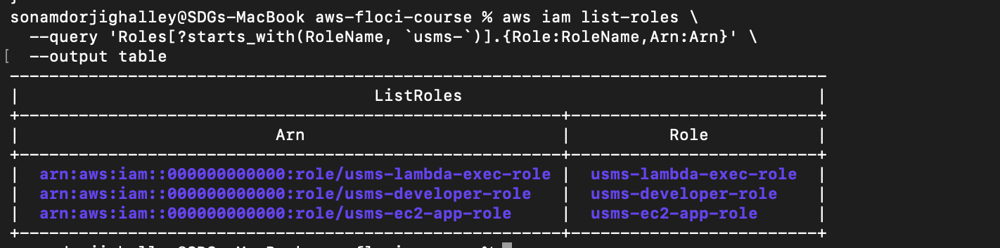

**Screenshot 10: Access key safety verification**


This screenshot verifies that the access key exists and that the secret-bearing output file is ignored by Git.

```bash
aws iam list-access-keys --user-name usms-dev-01 \
  --query 'AccessKeyMetadata[*].{Key:AccessKeyId,Status:Status,Created:CreateDate}' \
  --output table

git status --porcelain
git check-ignore -v outputs/usms-dev-01-access-key.json
ls -l outputs/usms-dev-01-access-key.json
```

Expected evidence: the access key metadata should be visible, and Git should show that `outputs/usms-dev-01-access-key.json` is ignored.


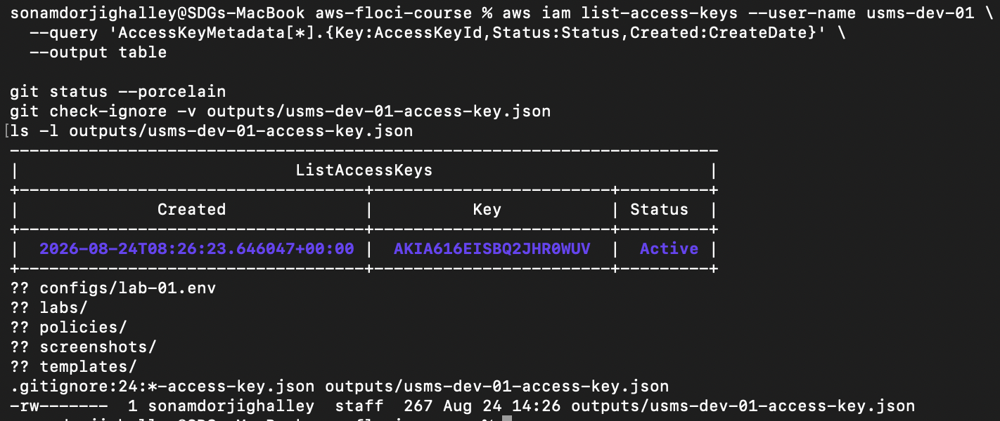

**Screenshot 11: Lab state file verification**

This screenshot verifies the generated non-secret lab state file used by later labs.

```bash
cat configs/lab-01.env

grep -n 'export .*=$\|None' configs/lab-01.env || echo "all values populated"
```

Expected evidence: `configs/lab-01.env` should contain the generated IAM names and ARNs, and the final command should show that all values are populated.


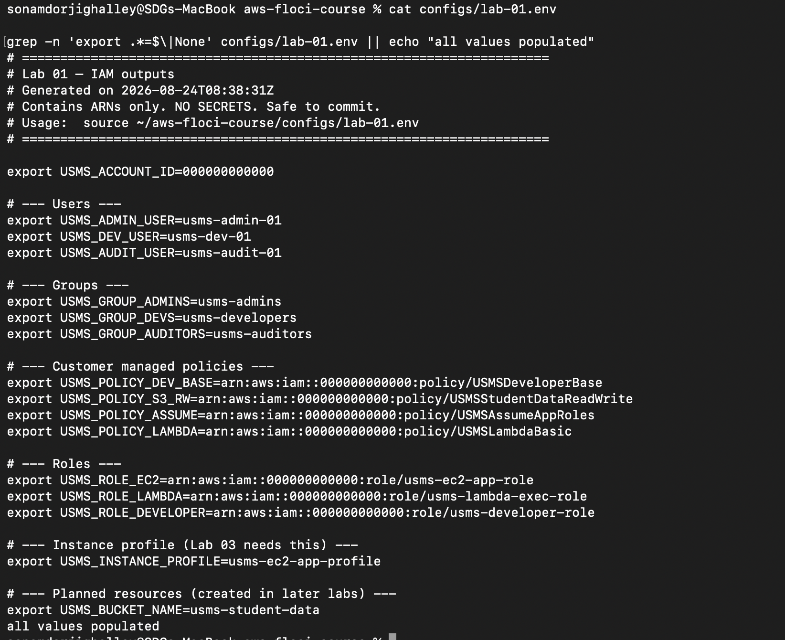

Generated local evidence:

- `configs/lab-01.env` contains non-secret IAM names and ARNs.
- `outputs/assumed-role.json` contains the STS assume-role output.
- `outputs/usms-dev-01-access-key.json` contains access key output and must not be shared publicly.
- `outputs/lab-01-iam-snapshot.json` exists but is currently empty, so the snapshot evidence should be regenerated or replaced with a Floci snapshot screenshot.

Important: do not include an unredacted screenshot of `outputs/assumed-role.json` or `outputs/usms-dev-01-access-key.json`, because those files may contain credentials.

#### 6.2 AWS Management Console Verification

This practical used Floci as a local AWS emulator, so the work was verified through CLI inspection rather than the AWS Management Console.

**Console-equivalent verification**

Use the CLI evidence above as the console-equivalent verification for this lab.


Verified that IAM users for admin, developer, and auditor access were created successfully.


verified that IAM roles, trust policies, attached policies, and the EC2 instance profile were configured successfully.


verified the complete Lab 01 IAM setup using the final inspection or verification commands.

### 7. Analysis and Discussion

The practical successfully created a complete IAM baseline for the USMS project. The expected users, groups, customer managed policies, inline policy, roles, trust relationships, instance profile, and STS temporary credentials were configured using the AWS CLI. The results matched the expected outcome because IAM resources were visible through list and get commands, generated ARNs were saved in `configs/lab-01.env`, and STS returned temporary credentials for the developer role.

The lab also demonstrated good IAM design practices. Permissions were mainly assigned through groups and roles rather than directly to users, making the setup easier to manage and scale. Roles were used for machine identities such as EC2 and Lambda, which avoids storing long-term credentials in applications. The developer role showed how real cloud environments grant elevated permissions temporarily instead of giving permanent high-privilege access.

No major implementation errors are recorded in the current report. However, all numbered screenshots in Section 6 should be added before final submission. The file `outputs/lab-01-iam-snapshot.json` is also empty, so the snapshot command or final inspection command should be run again if snapshot evidence is required. Secret-bearing output such as access keys should be redacted before being included in any screenshot.

Important observations:

- Using `configs/course.env` and `configs/lab-01.env` made the lab reproducible.
- Customer managed policies were easier to inspect and version because they were stored as JSON files.
- Trust policies and permission policies have different purposes and must both be configured correctly for roles to work.
- The AWS CLI `--query` option was useful for extracting ARNs and checking specific resource values.
- The local Floci environment allowed IAM concepts to be practiced without touching a real AWS account.

### 8. Reflection

1. I learned that IAM is the foundation of AWS security because every user, service, and application needs properly scoped permissions before it can access cloud resources.
2. I learned how users, groups, policies, roles, trust policies, instance profiles, access keys, and STS temporary credentials work together.
3. The main challenge was keeping track of different policy types, especially the difference between a permissions policy and a trust policy.
4. Another challenge was handling credentials safely, because access key output must be kept out of Git and should not be exposed in screenshots.
5. In a real-world cloud environment, I would use IAM groups for team-based permissions, IAM roles for applications, and STS assume-role for temporary elevated access.
6. I would like to explore IAM Access Analyzer, permission boundaries, service control policies, MFA-based conditions, and the IAM policy simulator in a real AWS account.

### 9. Conclusion

This practical successfully achieved its objectives by setting up a local AWS-compatible environment and building a complete IAM foundation for the USMS project. The lab created human identities, grouped users by responsibility, defined reusable policies, configured service roles, created an EC2 instance profile, and tested temporary access using STS.

The practical helped develop important cloud security skills, especially IAM policy writing, CLI-based resource management, least-privilege design, and safe credential handling. IAM is one of the most important AWS services because it controls who can access cloud resources, what actions they can perform, and how applications securely receive permissions.

#### AWS acedemic console screenshoot 

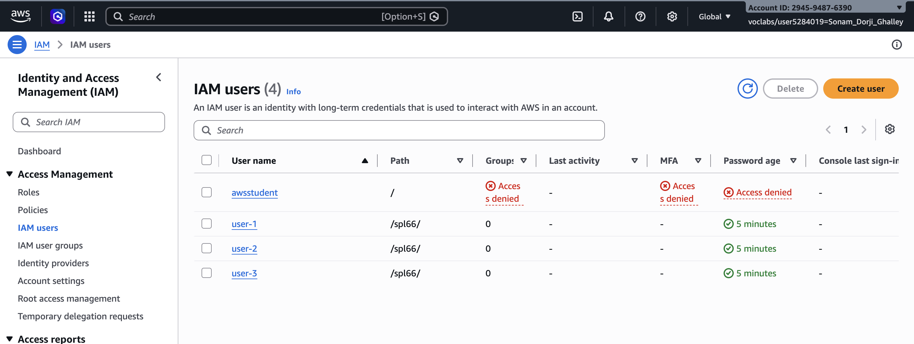

---
