# Lab 01 – Independent IAM Exercises

This document records the implementation, commands, verification, and outcomes of the independent exercises completed as part of **Lab 01 – AWS Identity and Access Management (IAM)**.

Before starting the exercises, the Floci environment was started and the AWS CLI configuration was verified.

```bash
cd ~/aws-floci-course
source configs/course.env
./scripts/setup/floci-up.sh
./scripts/utilities/whoami.sh
```

The AWS CLI was confirmed to be connected to the local Floci environment using account:

```text
000000000000
```

---

# Exercise 1 – The QA Identity

## Objective

The objective of this exercise was to create a new IAM identity for the Quality Assurance team. A group named `usms-qa` and a user named `usms-qa-01` were created. The existing `USMSDeveloperBase` policy was attached to the group rather than directly to the user.

The user was also tagged to identify its role and associated project.

## Implementation

First, the project directory was opened and the Floci environment configuration was loaded.

```bash
cd ~/aws-floci-course
source configs/course.env
```

### 1. Create the QA Group

```bash
aws iam create-group --group-name usms-qa
```

### 2. Create the QA User and Capture the ARN

The user was created with the required tags. The ARN was captured into the `QA_USER_ARN` shell variable using `--query` and `--output text`.

```bash
QA_USER_ARN=$(aws iam create-user \
  --user-name usms-qa-01 \
  --tags Key=Role,Value=QA Key=Project,Value=USMS \
  --query 'User.Arn' \
  --output text)

echo "$QA_USER_ARN"
```

Expected ARN format:

```text
arn:aws:iam::000000000000:user/usms-qa-01
```

### 3. Add the User to the QA Group

```bash
aws iam add-user-to-group \
  --group-name usms-qa \
  --user-name usms-qa-01
```

### 4. Find the Existing Developer Policy ARN

```bash
DEV_POLICY_ARN=$(aws iam list-policies \
  --scope Local \
  --query "Policies[?PolicyName=='USMSDeveloperBase'].Arn | [0]" \
  --output text)

echo "$DEV_POLICY_ARN"
```

### 5. Attach the Existing Policy to the QA Group

```bash
aws iam attach-group-policy \
  --group-name usms-qa \
  --policy-arn "$DEV_POLICY_ARN"
```

The policy was attached to the **group**, not directly to the user.

## Verification

The QA group membership was verified using:

```bash
aws iam get-group \
  --group-name usms-qa \
  --query 'Users[*].UserName' \
  --output table
```

### Output

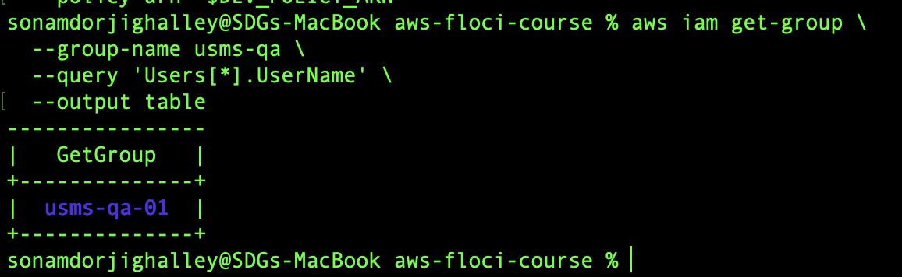

The policy attached to the QA group was verified using:

```bash
aws iam list-attached-group-policies \
  --group-name usms-qa \
  --output table
```

### Output

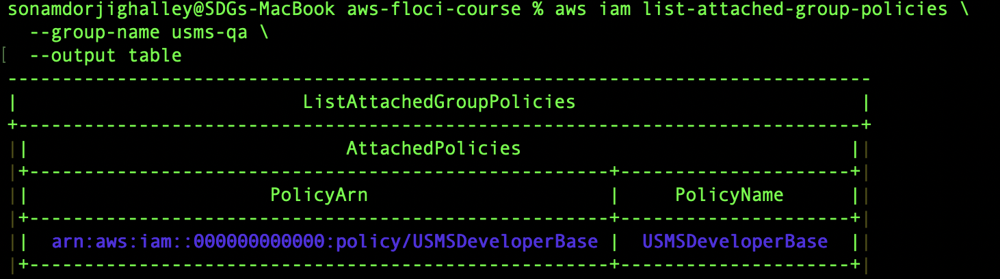

Finally, the user was checked to confirm that no managed policy had been attached directly:

```bash
aws iam list-attached-user-policies \
  --user-name usms-qa-01 \
  --output table
```

### Output

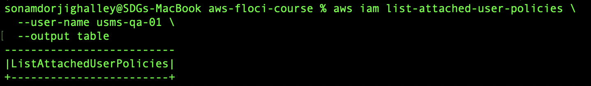

## Result

The `usms-qa` IAM group and `usms-qa-01` user were successfully created. The user was assigned to the QA group and inherited the existing `USMSDeveloperBase` permissions through group membership. No managed policies were attached directly to the user.

---

# Exercise 2 – Read-Only Reporting Policy

## Objective

The objective of this exercise was to create a least-privilege customer-managed IAM policy called `USMSReportingReadOnly`.

The policy allows a reporting service to:

* List the `usms-student-data` bucket.
* Read objects only from the `transcripts/` prefix.
* Never upload, modify, or delete data.

## Implementation

The policy file was created under the project's `policies/` directory.

```bash
cd ~/aws-floci-course/policies
```

### 1. Create the Policy Document

```bash
cat > usms-reporting-readonly-policy.json << 'EOF'
{
  "Version": "2012-10-17",
  "Statement": [
    {
      "Sid": "ListTranscriptPrefix",
      "Effect": "Allow",
      "Action": [
        "s3:ListBucket"
      ],
      "Resource": "arn:aws:s3:::usms-student-data",
      "Condition": {
        "StringLike": {
          "s3:prefix": [
            "transcripts",
            "transcripts/*"
          ]
        }
      }
    },
    {
      "Sid": "ReadTranscriptObjects",
      "Effect": "Allow",
      "Action": [
        "s3:GetObject"
      ],
      "Resource": "arn:aws:s3:::usms-student-data/transcripts/*"
    },
    {
      "Sid": "DenyTranscriptModification",
      "Effect": "Deny",
      "Action": [
        "s3:Put*",
        "s3:Delete*"
      ],
      "Resource": [
        "arn:aws:s3:::usms-student-data",
        "arn:aws:s3:::usms-student-data/*"
      ]
    }
  ]
}
EOF
```

### 2. Validate the JSON

Before submitting the policy to IAM, the JSON document was validated locally.

```bash
python3 -m json.tool usms-reporting-readonly-policy.json > /dev/null && echo "Valid JSON"
```

### Output

```text
Valid JSON
```

### 3. Create the Customer-Managed Policy

```bash
REPORT_POLICY_ARN=$(aws iam create-policy \
  --policy-name USMSReportingReadOnly \
  --description "Read-only access to USMS transcript reports" \
  --policy-document file://usms-reporting-readonly-policy.json \
  --query 'Policy.Arn' \
  --output text)

echo "$REPORT_POLICY_ARN"
```

Expected ARN:

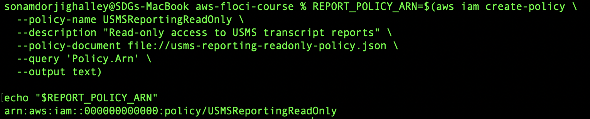

### 4. Verify the Policy

```bash
aws iam list-policies \
  --scope Local \
  --query "Policies[?PolicyName=='USMSReportingReadOnly'].{Name:PolicyName,Arn:Arn}" \
  --output table
```

### Output

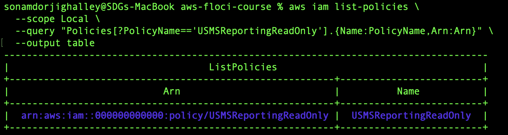


## Result

The `USMSReportingReadOnly` customer-managed IAM policy was successfully created. It allows listing the required S3 prefix and reading transcript objects while explicitly denying S3 upload and deletion operations.

The use of explicit `Deny` provides an additional security control because an explicit deny takes precedence over an allow that might be granted by another policy.

---

# Exercise 3 – Third-Party Analytics Role

## Objective

The objective of this exercise was to create an IAM role named:

```text
usms-analytics-partner-role
```

for temporary third-party analytics access.

The role was designed to:

* Be assumed by `usms-audit-01`.
* Limit the session to 30 minutes.
* Read only objects under `usms-student-data/reports/`.
* Use temporary STS credentials.
* Avoid permanent credentials for the partner.

---

## 3.1 Create the Trust Policy

```bash
cd ~/aws-floci-course/policies
```

```bash
cat > trust-analytics-partner.json << 'EOF'
{
  "Version": "2012-10-17",
  "Statement": [
    {
      "Sid": "AllowAuditUserToAssumeAnalyticsRole",
      "Effect": "Allow",
      "Principal": {
        "AWS": "arn:aws:iam::000000000000:user/usms-audit-01"
      },
      "Action": "sts:AssumeRole"
    }
  ]
}
EOF
```

Validate:

```bash
python3 -m json.tool trust-analytics-partner.json > /dev/null && echo "Valid trust policy"
```

---

## 3.2 Create the Role Permissions Policy

```bash
cat > usms-analytics-reports-readonly-policy.json << 'EOF'
{
  "Version": "2012-10-17",
  "Statement": [
    {
      "Sid": "ReadUSMSReports",
      "Effect": "Allow",
      "Action": [
        "s3:GetObject"
      ],
      "Resource": "arn:aws:s3:::usms-student-data/reports/*"
    }
  ]
}
EOF
```

Validate:

```bash
python3 -m json.tool usms-analytics-reports-readonly-policy.json > /dev/null && echo "Valid permissions policy"
```

---

## 3.3 Create the Analytics Role

```bash
aws iam create-role \
  --role-name usms-analytics-partner-role \
  --assume-role-policy-document file://trust-analytics-partner.json \
  --max-session-duration 3600 \
  --tags Key=Project,Value=USMS Key=External,Value=true
```

---

## 3.4 Create and Attach the Reporting Permission Policy

```bash
ANALYTICS_READ_ARN=$(aws iam create-policy \
  --policy-name USMSAnalyticsReportsReadOnly \
  --description "Read-only access to USMS report objects for analytics partner" \
  --policy-document file://usms-analytics-reports-readonly-policy.json \
  --query 'Policy.Arn' \
  --output text)

echo "$ANALYTICS_READ_ARN"
```

Attach it to the role:

```bash
aws iam attach-role-policy \
  --role-name usms-analytics-partner-role \
  --policy-arn "$ANALYTICS_READ_ARN"
```

---

## 3.5 Allow the Auditor to Assume the Role

The trust policy identifies who the role trusts. The calling identity must also have permission to perform `sts:AssumeRole`.

A separate policy was therefore created.

```bash
cat > usms-assume-analytics-partner-policy.json << 'EOF'
{
  "Version": "2012-10-17",
  "Statement": [
    {
      "Sid": "AssumeAnalyticsPartnerRole",
      "Effect": "Allow",
      "Action": [
        "sts:AssumeRole"
      ],
      "Resource": "arn:aws:iam::000000000000:role/usms-analytics-partner-role"
    }
  ]
}
EOF
```

Validate:

```bash
python3 -m json.tool usms-assume-analytics-partner-policy.json > /dev/null && echo "Valid JSON"
```

Create the policy:

```bash
ANALYTICS_ASSUME_ARN=$(aws iam create-policy \
  --policy-name USMSAssumeAnalyticsPartner \
  --description "Allows USMS auditors to assume the analytics partner role" \
  --policy-document file://usms-assume-analytics-partner-policy.json \
  --query 'Policy.Arn' \
  --output text)

echo "$ANALYTICS_ASSUME_ARN"
```

Attach it to the auditor group:

```bash
aws iam attach-group-policy \
  --group-name usms-auditors \
  --policy-arn "$ANALYTICS_ASSUME_ARN"
```

---

## 3.6 Verify the Role

```bash
aws iam get-role \
  --role-name usms-analytics-partner-role \
  --query 'Role.{RoleName:RoleName,MaxSessionDuration:MaxSessionDuration,Arn:Arn}' \
  --output table
```

### Output

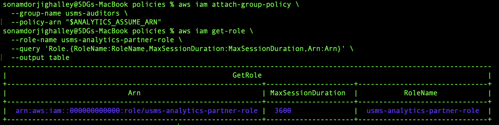

The expected maximum session duration for this course exercise is:

```text
3600 seconds
```

---

## 3.7 Obtain Temporary Credentials

Return to the project root:

```bash
cd ~/aws-floci-course
```

Temporary credentials were requested using AWS STS:

```bash
aws sts assume-role \
  --role-arn arn:aws:iam::000000000000:role/usms-analytics-partner-role \
  --role-session-name usms-analytics-test \
  --duration-seconds 1800 \
  > outputs/usms-analytics-partner-assumed-role.json
```

Protect the credential file:

```bash
chmod 600 outputs/usms-analytics-partner-assumed-role.json
```

Display only the expiration time:

```bash
python3 - << 'PY'
import json

with open("outputs/usms-analytics-partner-assumed-role.json") as f:
    data = json.load(f)

print("Expiration:", data["Credentials"]["Expiration"])
PY
```

### Expiration Received

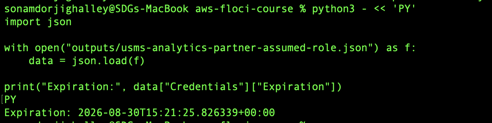

The temporary credentials were stored only in the Git-ignored `outputs/` directory.

## Result

The analytics partner IAM role was successfully created with a restricted trust relationship and limited S3 read permissions. AWS STS was used to obtain temporary credentials rather than creating permanent access keys.

---

# Exercise 4 – Least-Privilege Backup Operator

## Objective

The objective of this exercise was to translate a real job description into a least-privilege IAM design.

The backup workload must:

* Read objects from `usms-student-data`.
* Copy them to `usms-archive`.
* Verify the copied data.
* Write completion information to CloudWatch Logs.
* Never delete data.
* Never access IAM.
* Operate only in `us-east-1`.

A **role** was selected instead of a user because this is an automated workload rather than a human user. Roles provide temporary credentials and avoid storing long-lived access keys in an application.

For this implementation, the backup workload is assumed to be executed by AWS Lambda.

---

## 4.1 Create the Trust Policy

```bash
cd ~/aws-floci-course/policies
```

```bash
cat > trust-backup-operator.json << 'EOF'
{
  "Version": "2012-10-17",
  "Statement": [
    {
      "Sid": "AllowLambdaBackupJob",
      "Effect": "Allow",
      "Principal": {
        "Service": "lambda.amazonaws.com"
      },
      "Action": "sts:AssumeRole"
    }
  ]
}
EOF
```

Validate:

```bash
python3 -m json.tool trust-backup-operator.json > /dev/null && echo "Valid trust policy"
```

---

## 4.2 Create the Least-Privilege Permissions Policy

```bash
cat > usms-backup-operator-policy.json << 'EOF'
{
  "Version": "2012-10-17",
  "Statement": [
    {
      "Sid": "ReadStudentData",
      "Effect": "Allow",
      "Action": [
        "s3:ListBucket",
        "s3:GetObject"
      ],
      "Resource": [
        "arn:aws:s3:::usms-student-data",
        "arn:aws:s3:::usms-student-data/*"
      ],
      "Condition": {
        "StringEquals": {
          "aws:RequestedRegion": "us-east-1"
        }
      }
    },
    {
      "Sid": "WriteAndVerifyArchive",
      "Effect": "Allow",
      "Action": [
        "s3:ListBucket",
        "s3:PutObject",
        "s3:GetObject"
      ],
      "Resource": [
        "arn:aws:s3:::usms-archive",
        "arn:aws:s3:::usms-archive/*"
      ],
      "Condition": {
        "StringEquals": {
          "aws:RequestedRegion": "us-east-1"
        }
      }
    },
    {
      "Sid": "WriteBackupCompletionLogs",
      "Effect": "Allow",
      "Action": [
        "logs:CreateLogStream",
        "logs:PutLogEvents"
      ],
      "Resource": "arn:aws:logs:us-east-1:000000000000:log-group:/aws/usms/backup:*",
      "Condition": {
        "StringEquals": {
          "aws:RequestedRegion": "us-east-1"
        }
      }
    },
    {
      "Sid": "ExplicitlyDenyDeletionAndIAM",
      "Effect": "Deny",
      "Action": [
        "s3:Delete*",
        "iam:*"
      ],
      "Resource": "*"
    }
  ]
}
EOF
```

The policy contains four statements, which satisfies the exercise constraint.

There is no `"Action": "*"` and none of the **Allow** statements use `"Resource": "*"`.

A copy operation does not require a fictitious `s3:CopyObject` permission. The workload needs permission to read the source object with `s3:GetObject` and create the destination object with `s3:PutObject`.

---

## 4.3 Validate the Policy

```bash
python3 -m json.tool usms-backup-operator-policy.json > /dev/null && echo "Valid JSON"
```

### Output

```text
Valid JSON
```

---

## 4.4 Create the Backup Operator Role

```bash
aws iam create-role \
  --role-name usms-backup-operator-role \
  --assume-role-policy-document file://trust-backup-operator.json \
  --tags Key=Project,Value=USMS Key=Role,Value=BackupOperator
```

---

## 4.5 Create the Backup Policy

```bash
BACKUP_POLICY_ARN=$(aws iam create-policy \
  --policy-name USMSBackupOperator \
  --description "Least privilege permissions for the USMS nightly backup workload" \
  --policy-document file://usms-backup-operator-policy.json \
  --query 'Policy.Arn' \
  --output text)

echo "$BACKUP_POLICY_ARN"
```

---

## 4.6 Attach the Policy to the Role

```bash
aws iam attach-role-policy \
  --role-name usms-backup-operator-role \
  --policy-arn "$BACKUP_POLICY_ARN"
```

---

## 4.7 Verify the Role

```bash
aws iam get-role \
  --role-name usms-backup-operator-role \
  --query 'Role.{Role:RoleName,Arn:Arn}' \
  --output table
```

### Output

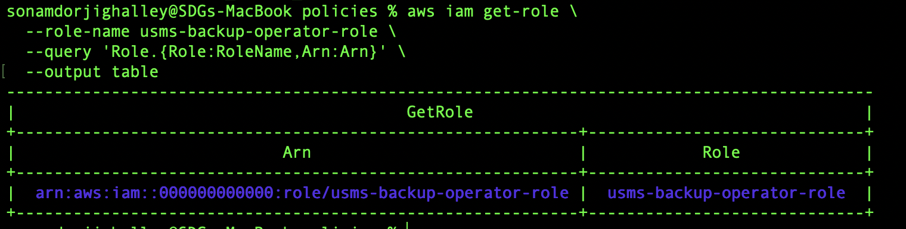

Verify the attached policy:

```bash
aws iam list-attached-role-policies \
  --role-name usms-backup-operator-role \
  --output table
```

### Output

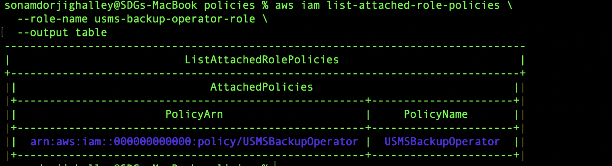

## Result

A dedicated IAM role was created for the automated backup workload. The permissions follow the principle of least privilege by granting only the S3 and CloudWatch Logs actions required by the job.

No delete or IAM operations are allowed, and the permitted workload operations are restricted to `us-east-1`.

---

# Exercise 5 – Prepare the Identity for Lab 2

## Objective

The objective of this exercise was to verify whether `usms-dev-01` had all permissions necessary for the VPC practical in Lab 2 and update `USMSDeveloperBase` accordingly.

The permissions required by Lab 2 were reviewed against version 2 of the policy.

---

## 5.1 Required Lab 2 Permissions

The following permissions are required:

```text
ec2:CreateVpc
ec2:CreateSubnet
ec2:CreateInternetGateway
ec2:AttachInternetGateway
ec2:CreateRouteTable
ec2:CreateRoute
ec2:AssociateRouteTable
ec2:DescribeAvailabilityZones
ec2:ModifyVpcAttribute
ec2:CreateNatGateway
ec2:AllocateAddress
```

The policy simulator can first be attempted:

```bash
aws iam simulate-principal-policy \
  --policy-source-arn arn:aws:iam::000000000000:user/usms-dev-01 \
  --action-names \
  ec2:CreateVpc \
  ec2:CreateSubnet \
  ec2:CreateInternetGateway \
  ec2:AttachInternetGateway \
  ec2:CreateRouteTable \
  ec2:CreateRoute \
  ec2:AssociateRouteTable \
  ec2:DescribeAvailabilityZones \
  ec2:ModifyVpcAttribute \
  ec2:CreateNatGateway \
  ec2:AllocateAddress \
  --query 'EvaluationResults[*].{Action:EvalActionName,Decision:EvalDecision}' \
  --output table
```

### Simulator Output

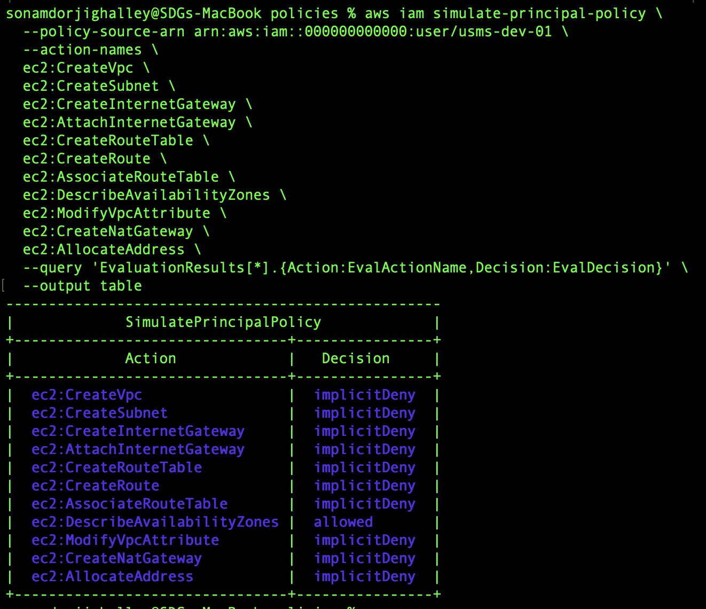

Floci may not fully support IAM policy simulation. Therefore, version 2 of the policy was also inspected manually.

---

## 5.2 Missing Permissions

After comparing `USMSDeveloperBase` version 2 against the Lab 2 requirements, the following two permissions were identified as missing:

```text
ec2:CreateNatGateway
ec2:AllocateAddress
```

All the other required permissions were already present in version 2.

---

## 5.3 Create Version 3 of USMSDeveloperBase

Move to the project root:

```bash
cd ~/aws-floci-course
```

Create the version 3 JSON document from version 2:

```bash
python3 - << 'PY'
import json
from pathlib import Path

source = Path("policies/usms-developer-base-policy-v2.json")
destination = Path("policies/usms-developer-base-policy-v3.json")

doc = json.loads(source.read_text())

missing_actions = [
    "ec2:CreateNatGateway",
    "ec2:AllocateAddress"
]

for statement in doc["Statement"]:
    if statement.get("Sid") == "BuildNetworkingForLab02":
        actions = statement["Action"]

        for action in missing_actions:
            if action not in actions:
                actions.append(action)

destination.write_text(json.dumps(doc, indent=2))

print("Created:", destination)
PY
```

Validate:

```bash
python3 -m json.tool policies/usms-developer-base-policy-v3.json > /dev/null && echo "Valid JSON"
```

---

## 5.4 Create Policy Version 3 and Make It Default

```bash
aws iam create-policy-version \
  --policy-arn arn:aws:iam::000000000000:policy/USMSDeveloperBase \
  --policy-document file://policies/usms-developer-base-policy-v3.json \
  --set-as-default
```

---

## 5.5 Verify Policy Versions

```bash
aws iam list-policy-versions \
  --policy-arn arn:aws:iam::000000000000:policy/USMSDeveloperBase \
  --query 'Versions[*].{Version:VersionId,Default:IsDefaultVersion}' \
  --output table
```

### Output

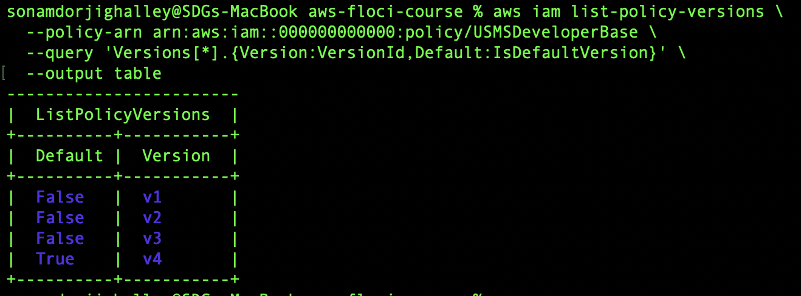


This confirms that the earlier policy versions remain available while version 3 is now active.

---

## 5.6 Add the VPC CIDR to `lab-01.env`

The VPC CIDR required for Lab 2 was added to the Lab 1 environment configuration.


```bash
echo 'export USMS_VPC_CIDR=10.0.0.0/16' >> configs/lab-01.env
```

Verify:

```bash
tail -5 configs/lab-01.env
```

The following variable was  present:

```text
export USMS_VPC_CIDR=10.0.0.0/16
```

Loading the configuration and verify the value:

```bash
source configs/lab-01.env
echo "$USMS_VPC_CIDR"
```

 result:

```text
10.0.0.0/16
```

---


The `USMSDeveloperBase` policy was successfully updated to version 3.

The two missing Lab 2 permissions:

```text
ec2:CreateNatGateway
ec2:AllocateAddress
```

were added without granting any additional unnecessary permissions.

Version 3 was set as the default while versions 1 and 2 were retained for rollback purposes. The `USMS_VPC_CIDR` variable was also added to `configs/lab-01.env`, preparing the environment for Lab 2.

---

# Overall Exercise Summary

The five independent IAM exercises were completed successfully.

The exercises demonstrated:

* Group-based IAM permission management.
* Creation and tagging of IAM users.
* Creation of customer-managed policies.
* S3 bucket and object-level permission design.
* Explicit deny and least-privilege principles.
* IAM trust policies.
* IAM roles for workloads and external access.
* Temporary credentials using AWS STS.
* Secure role-based application access.
* Region-restricted policies.
* IAM policy version management.
* Preparation of reusable IAM configuration for Lab 2.

The exercises further demonstrated that permissions should be assigned based on the specific responsibilities of each user or workload rather than granting broad administrative access.

---

# Files Created During the Exercises

The following additional files were created:

```text
policies/
├── usms-reporting-readonly-policy.json
├── trust-analytics-partner.json
├── usms-analytics-reports-readonly-policy.json
├── usms-assume-analytics-partner-policy.json
├── trust-backup-operator.json
├── usms-backup-operator-policy.json
└── usms-developer-base-policy-v3.json
```

The exercise record is stored at:

```text
labs/lab-01-iam/exercises.md
```

The configuration for future labs was updated in:

```text
configs/lab-01.env
```


---

# Final Git Check

Before committing, the repository was checked to ensure that no temporary credentials or other secret files were staged.

```bash
cd ~/aws-floci-course
git status --short
git check-ignore -v outputs/usms-analytics-partner-assumed-role.json
```

Only the required configuration, policy, exercise, and script files were added.

