# LAB 02 – VIRTUAL PRIVATE CLOUD AND NETWORKING

**Course:** DSO303  
**Practical:** Lab 02 – Virtual Private Cloud and Networking  
**Student Name:** Sonam Dorji Ghalley  
**Student ID:** 02230299

---

# 1. Aim / Objective

The aim of this practical was to design, create, configure and verify a secure Virtual Private Cloud (VPC) network for the University Student Management System (USMS) using the AWS Command Line Interface (AWS CLI) in the Floci AWS emulation environment.

The specific objectives of the practical were to:

- Create a custom VPC with an appropriate CIDR address range.
- Understand and apply CIDR notation when designing a VPC network.
- Create public and private subnets across multiple Availability Zones.
- Configure an Internet Gateway for public internet connectivity.
- Configure separate public and private route tables.
- Demonstrate the actual networking difference between a public and private subnet.
- Configure application and database security groups.
- Reference one security group as the source of another security group's rule.
- Create a custom Network Access Control List (NACL) for the private tier.
- Configure a NAT Gateway to provide outbound internet connectivity to private resources.
- Create an Amazon S3 Gateway VPC Endpoint.
- Use AWS CLI `--filters` and `--query` options for efficient information retrieval.
- Audit resource tags.
- Verify that the network configuration persists after restarting the Floci environment.
- Store all important network resource identifiers in `configs/lab-02.env` so that they can be reused in future practicals.

---

# 2. Introduction

Amazon Virtual Private Cloud (Amazon VPC) is an AWS networking service that enables users to create logically isolated virtual networks for cloud resources. Within a VPC, administrators can define private IP address ranges, divide the network into subnets, configure routing, attach gateways and implement security controls.

A VPC forms the networking foundation for many AWS services. Resources such as Amazon EC2 instances are deployed inside VPC subnets and depend on the network configuration for communication with other resources, AWS services and the internet.

A secure cloud architecture normally separates resources according to their connectivity and security requirements. Public-facing systems such as web servers may require internet connectivity, while systems containing sensitive information such as databases should remain protected from direct public access.

In this practical, a network was designed for a University Student Management System (USMS). The architecture contains a public application tier and a private data tier. The web tier must be accessible by students and staff, whereas the database tier contains sensitive student information such as transcripts and enrolment records and therefore must not be directly reachable from the public internet.

The private tier still requires controlled outbound connectivity for activities such as downloading operating-system and security updates. For this reason, the architecture includes a NAT Gateway. An S3 Gateway VPC Endpoint was also configured to provide an AWS service path from the private network to Amazon S3.

---

# 3. Use Case

The use case implemented in this practical is a **University Student Management System (USMS)**.

The system contains two major tiers.

## 3.1 Public/Application Tier

The public application tier provides services that students and staff need to access over the internet.

Therefore, this tier requires:

- public subnets;
- automatic public IPv4 assignment;
- a route to an Internet Gateway;
- HTTP access;
- HTTPS access; and
- restricted administrative access.

The public subnets are associated with a public route table containing:

```text
0.0.0.0/0 -> Internet Gateway
```

## 3.2 Private/Data Tier

The data tier stores sensitive university information such as:

- student transcripts;
- enrolment records;
- academic information; and
- other protected university data.

The database tier must not be directly reachable from the public internet.

Therefore, the private tier is placed in private subnets that do not have a direct route to the Internet Gateway.

The database security group accepts PostgreSQL connections only from the application security group.

## 3.3 Outbound Access Requirement

Although the database tier must remain private, it still needs to initiate outbound connections for:

- operating-system updates;
- security patches; and
- other required external services.

A NAT Gateway was therefore placed in a public subnet. The private route table sends default outbound traffic to the NAT Gateway.

---

# 4. System Architecture / Design

The VPC was created with the following CIDR range:

```text
10.0.0.0/16
```

This provides 65,536 IPv4 addresses and allows the VPC to be divided into multiple smaller `/24` subnets.

The subnet address plan was:

| Resource | CIDR | Availability Zone | Purpose |
|---|---|---|---|
| `usms-vpc` | `10.0.0.0/16` | Region | Entire USMS network |
| `usms-public-subnet-a` | `10.0.1.0/24` | us-east-1a | Public application tier |
| `usms-public-subnet-b` | `10.0.2.0/24` | us-east-1b | Public application tier |
| `usms-private-subnet-a` | `10.0.3.0/24` | us-east-1a | Private data tier |
| `usms-private-subnet-b` | `10.0.4.0/24` | us-east-1b | Private data tier |

Each `/24` subnet contains 256 addresses. AWS reserves five addresses in every subnet, leaving 251 usable addresses.

The overall architecture can be represented as:

```text
                           Internet
                              |
                        usms-igw
                   Internet Gateway
                              |
            +-----------------+-----------------+
            |                                   |
     Public Subnet A                    Public Subnet B
       10.0.1.0/24                        10.0.2.0/24
       us-east-1a                         us-east-1b
            |
        usms-nat
       NAT Gateway
            |
      usms-private-rt
            |
     +------+------+
     |             |
Private Subnet A   Private Subnet B
 10.0.3.0/24        10.0.4.0/24
 us-east-1a         us-east-1b

Application Security:
usms-app-sg

Database Security:
usms-db-sg
TCP 5432 from usms-app-sg

Subnet Security:
usms-private-nacl

AWS Service Access:
usms-s3-endpoint
```

---

# 5. Tools and Prerequisites

The following tools and previously configured resources were required:

- AWS CLI v2
- Docker
- Docker Compose
- Floci AWS emulator
- Bash shell
- `jq`
- Git
- Lab 01 IAM resources
- `configs/course.env`
- `configs/lab-01.env`
- `usms-developer-role`
- `usms-dev-01`
- `USMSDeveloperBase`
- `usms-ec2-app-profile`

Unless otherwise stated, all commands in this practical were executed from:

```bash
cd ~/aws-floci-course
```

---

# 6. Procedure / Implementation

## Step 1 – Resume and Verify the Floci Environment

The first step was to confirm that the Floci AWS emulation environment was running and using persistent storage.

### Commands Used

```bash
cd ~/aws-floci-course

./scripts/setup/floci-up.sh
./scripts/utilities/floci-storage-check.sh
```


This step was important because a memory-only Floci configuration would cause the created network resources to disappear after the environment was restarted.

### Screenshot

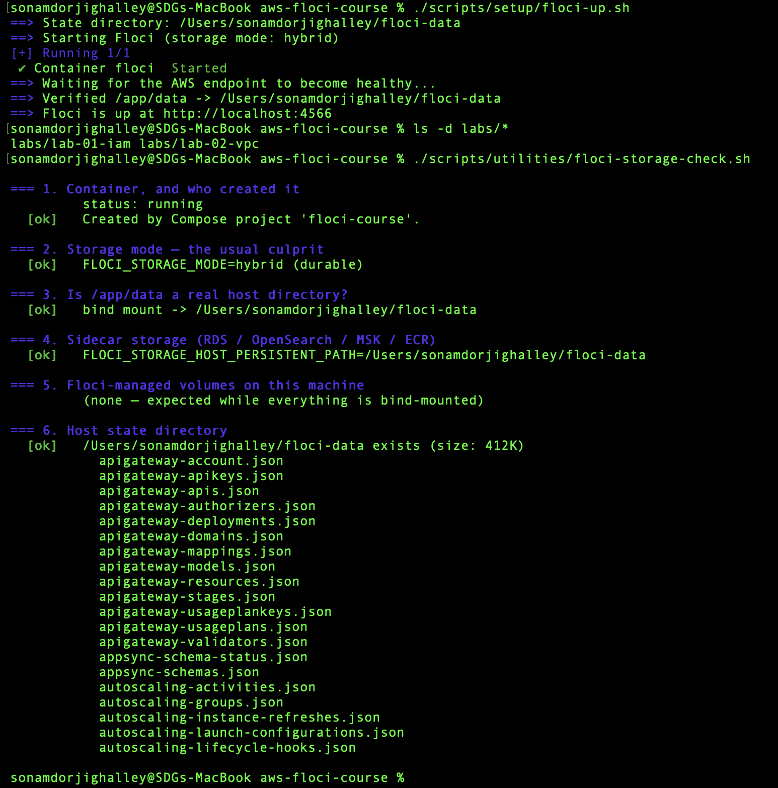


---

## Step 2 – Load the Previous Lab Environment and Verify Identity

Lab 02 reused IAM resources created during Lab 01.

The environment configuration files were sourced.

### Commands Used

```bash
source configs/course.env
source configs/lab-01.env

./scripts/utilities/whoami.sh

echo "developer role : $USMS_ROLE_DEVELOPER"
echo "developer user : $USMS_DEV_USER"
echo "account        : $USMS_ACCOUNT_ID"
```

The expected account was:

```text
000000000000
```

The developer role and user were:

```text
usms-developer-role
usms-dev-01
```

This verified that the commands were being executed against the course Floci environment rather than a real AWS account.

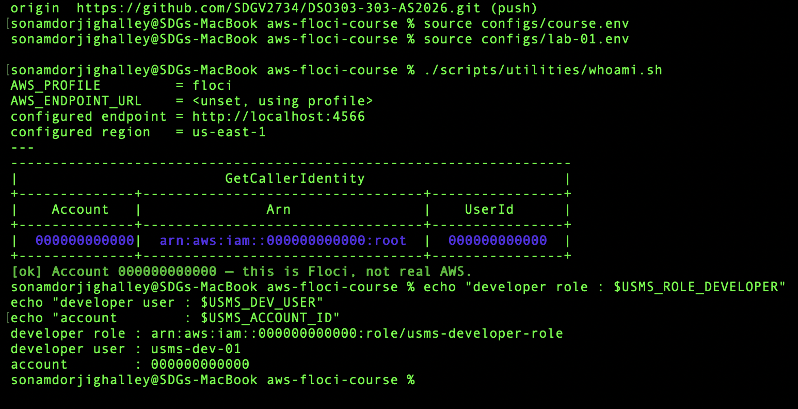
---

## Step 3 – Assume the Developer Role and Create the VPC

The `USMSDeveloperBase` policy was checked before the developer role was used.

### Commands Used

```bash
POLICY_ARN="arn:aws:iam::${USMS_ACCOUNT_ID}:policy/USMSDeveloperBase"

DEFAULT_VERSION=$(aws iam get-policy \
  --policy-arn "$POLICY_ARN" \
  --query 'Policy.DefaultVersionId' \
  --output text)

echo "default version: $DEFAULT_VERSION"
```

The developer role was then assumed.

```bash
ROLE_ARN="arn:aws:iam::${USMS_ACCOUNT_ID}:role/${USMS_ROLE_DEVELOPER}"

aws sts assume-role \
  --role-arn "$ROLE_ARN" \
  --role-session-name "lab02-vpc-build" \
  --profile usms-dev \
  > outputs/lab-02-assumed-role.json
```

The file containing the temporary credentials was protected:

```bash
chmod 600 outputs/lab-02-assumed-role.json
```

Temporary credentials were loaded:

```bash
export AWS_ACCESS_KEY_ID=$(jq -r '.Credentials.AccessKeyId' outputs/lab-02-assumed-role.json)

export AWS_SECRET_ACCESS_KEY=$(jq -r '.Credentials.SecretAccessKey' outputs/lab-02-assumed-role.json)

export AWS_SESSION_TOKEN=$(jq -r '.Credentials.SessionToken' outputs/lab-02-assumed-role.json)
```

The assumed identity was verified:

```bash
aws sts get-caller-identity --no-cli-pager
```

The ARN contained:

```text
assumed-role/usms-developer-role/lab02-vpc-build
```

The VPC was then created.

```bash
VPC_ID=$(aws ec2 create-vpc \
  --cidr-block 10.0.0.0/16 \
  --tag-specifications 'ResourceType=vpc,Tags=[{Key=Name,Value=usms-vpc},{Key=Project,Value=USMS},{Key=Tier,Value=network},{Key=ManagedBy,Value=aws-cli}]' \
  --query 'Vpc.VpcId' \
  --output text)

echo "VPC_ID = $VPC_ID"
```

### Screenshot

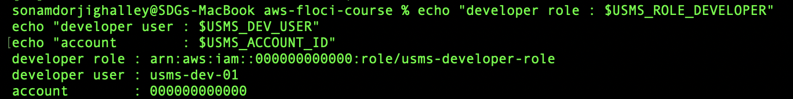

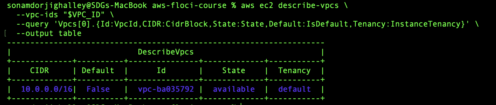


---

## Step 4 – Restore the Normal Identity and Verify the VPC

The temporary role credentials were removed immediately after the VPC creation.

### Commands Used

```bash
unset AWS_ACCESS_KEY_ID AWS_SECRET_ACCESS_KEY AWS_SESSION_TOKEN

./scripts/utilities/whoami.sh
```

The VPC was then verified.

```bash
aws ec2 describe-vpcs \
  --vpc-ids "$VPC_ID" \
  --query 'Vpcs[0].{Id:VpcId,CIDR:CidrBlock,State:State,Default:IsDefault,Tenancy:InstanceTenancy}' \
  --output table
```

The important result was:

```text
CIDR       10.0.0.0/16
State      available
Default    False
```

### Screenshot

**[INSERT SCREENSHOT HERE – VPC DESCRIPTION TABLE]**

**Figure 3. USMS VPC successfully created with CIDR `10.0.0.0/16`.**

---

## Step 5 – Enable DNS Support and DNS Hostnames

DNS support and DNS hostname functionality were enabled.

### Commands Used

```bash
aws ec2 modify-vpc-attribute \
  --vpc-id "$VPC_ID" \
  --enable-dns-support '{"Value":true}'
```

```bash
aws ec2 modify-vpc-attribute \
  --vpc-id "$VPC_ID" \
  --enable-dns-hostnames '{"Value":true}'
```

Verification:

```bash
aws ec2 describe-vpc-attribute \
  --vpc-id "$VPC_ID" \
  --attribute enableDnsSupport \
  --query 'EnableDnsSupport.Value' \
  --output text
```

```bash
aws ec2 describe-vpc-attribute \
  --vpc-id "$VPC_ID" \
  --attribute enableDnsHostnames \
  --query 'EnableDnsHostnames.Value' \
  --output text
```

Both attributes returned:

```text
True
```

---

## Step 6 – Create and Attach the Internet Gateway

An Internet Gateway named `usms-igw` was created.

### Commands Used

```bash
IGW_ID=$(aws ec2 create-internet-gateway \
  --tag-specifications 'ResourceType=internet-gateway,Tags=[{Key=Name,Value=usms-igw},{Key=Project,Value=USMS}]' \
  --query 'InternetGateway.InternetGatewayId' \
  --output text)

echo "IGW_ID = $IGW_ID"
```

The gateway was attached to the VPC.

```bash
aws ec2 attach-internet-gateway \
  --internet-gateway-id "$IGW_ID" \
  --vpc-id "$VPC_ID"
```

Verification:

```bash
aws ec2 describe-internet-gateways \
  --internet-gateway-ids "$IGW_ID" \
  --query 'InternetGateways[0].{Id:InternetGatewayId,Attachments:Attachments}' \
  --output json
```

The output confirmed that the Internet Gateway was attached to `usms-vpc`.

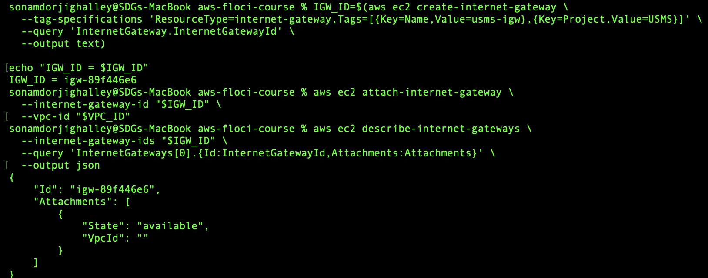
---

## Step 7 – Create Public Subnet A

The first public subnet was created in Availability Zone `us-east-1a`.

### Command Used

```bash
PUBLIC_SUBNET_A_ID=$(aws ec2 create-subnet \
  --vpc-id "$VPC_ID" \
  --cidr-block 10.0.1.0/24 \
  --availability-zone "${AWS_REGION_COURSE}a" \
  --tag-specifications 'ResourceType=subnet,Tags=[{Key=Name,Value=usms-public-subnet-a},{Key=Project,Value=USMS},{Key=Tier,Value=public},{Key=AZ,Value=a}]' \
  --query 'Subnet.SubnetId' \
  --output text)

echo "PUBLIC_SUBNET_A_ID = $PUBLIC_SUBNET_A_ID"
```

Verification:

```bash
aws ec2 describe-subnets \
  --subnet-ids "$PUBLIC_SUBNET_A_ID" \
  --query 'Subnets[0].{Id:SubnetId,CIDR:CidrBlock,AZ:AvailabilityZone,Free:AvailableIpAddressCount,PublicIP:MapPublicIpOnLaunch,State:State}' \
  --output table
```

The subnet showed approximately:

```text
CIDR      10.0.1.0/24
AZ        us-east-1a
Free      251
PublicIP  False
State     available
```
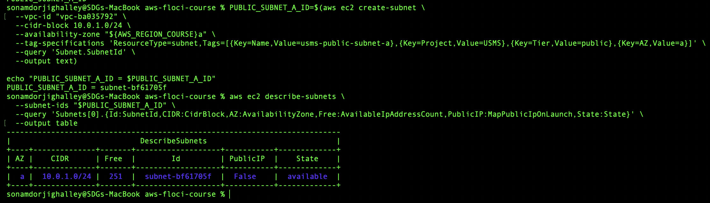
---

## Step 8 – Enable Automatic Public IPv4 Assignment

Public IPv4 auto-assignment was enabled for public subnet A.

### Commands Used

```bash
aws ec2 modify-subnet-attribute \
  --subnet-id "$PUBLIC_SUBNET_A_ID" \
  --map-public-ip-on-launch
```

Verification:

```bash
aws ec2 describe-subnets \
  --subnet-ids "$PUBLIC_SUBNET_A_ID" \
  --query 'Subnets[0].MapPublicIpOnLaunch' \
  --output text
```

The result was:

```text
True
```
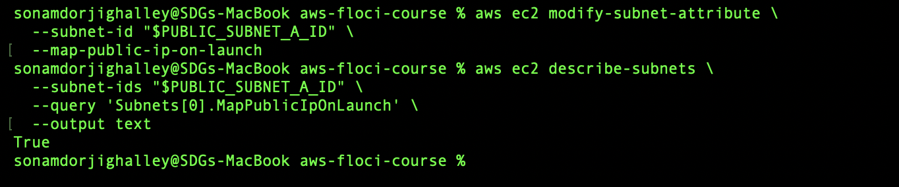
---

## Step 9 – Create Private Subnet A

The private subnet for the data tier was created in `us-east-1a`.

### Command Used

```bash
PRIVATE_SUBNET_A_ID=$(aws ec2 create-subnet \
  --vpc-id "$VPC_ID" \
  --cidr-block 10.0.3.0/24 \
  --availability-zone "${AWS_REGION_COURSE}a" \
  --tag-specifications 'ResourceType=subnet,Tags=[{Key=Name,Value=usms-private-subnet-a},{Key=Project,Value=USMS},{Key=Tier,Value=private},{Key=AZ,Value=a}]' \
  --query 'Subnet.SubnetId' \
  --output text)

echo "PRIVATE_SUBNET_A_ID = $PRIVATE_SUBNET_A_ID"
```

The subnets were inspected:

```bash
aws ec2 describe-subnets \
  --filters "Name=vpc-id,Values=$VPC_ID" \
  --query 'sort_by(Subnets,&CidrBlock)[].{Name:Tags[?Key==`Name`]|[0].Value,CIDR:CidrBlock,AZ:AvailabilityZone,Public:MapPublicIpOnLaunch}' \
  --output table
```


### Screenshot

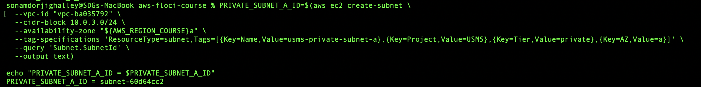

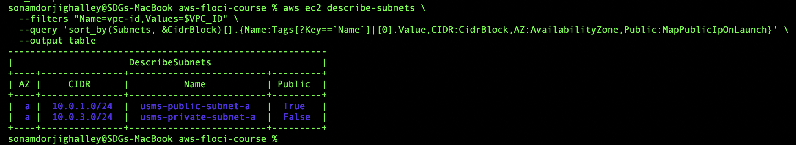

---

## Step 10 – Create the Public Route Table

A route table named `usms-public-rt` was created.

### Command Used

```bash
PUBLIC_RT_ID=$(aws ec2 create-route-table \
  --vpc-id "$VPC_ID" \
  --tag-specifications 'ResourceType=route-table,Tags=[{Key=Name,Value=usms-public-rt},{Key=Project,Value=USMS},{Key=Tier,Value=public}]' \
  --query 'RouteTable.RouteTableId' \
  --output text)

echo "PUBLIC_RT_ID = $PUBLIC_RT_ID"
```

A default route to the Internet Gateway was added.

```bash
aws ec2 create-route \
  --route-table-id "$PUBLIC_RT_ID" \
  --destination-cidr-block 0.0.0.0/0 \
  --gateway-id "$IGW_ID"
```

Verification:

```bash
aws ec2 describe-route-tables \
  --route-table-ids "$PUBLIC_RT_ID" \
  --query 'RouteTables[0].Routes[].{Destination:DestinationCidrBlock,Target:GatewayId,State:State}' \
  --output table
```

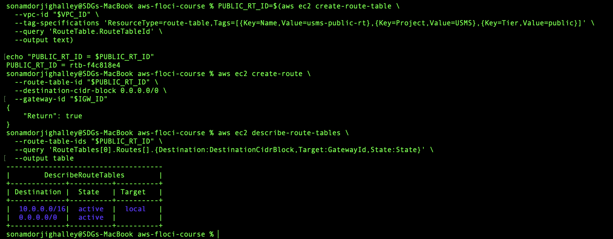


---

## Step 11 – Associate Public Subnet A and Create Public Subnet B

Public subnet A was associated with the public route table.

### Command Used

```bash
PUBLIC_ASSOC_A_ID=$(aws ec2 associate-route-table \
  --route-table-id "$PUBLIC_RT_ID" \
  --subnet-id "$PUBLIC_SUBNET_A_ID" \
  --query 'AssociationId' \
  --output text)

echo "PUBLIC_ASSOC_A_ID = $PUBLIC_ASSOC_A_ID"
```

The second public subnet was created in Availability Zone `us-east-1b`.

```bash
PUBLIC_SUBNET_B_ID=$(aws ec2 create-subnet \
  --vpc-id "$VPC_ID" \
  --cidr-block 10.0.2.0/24 \
  --availability-zone "${AWS_REGION_COURSE}b" \
  --tag-specifications 'ResourceType=subnet,Tags=[{Key=Name,Value=usms-public-subnet-b},{Key=Project,Value=USMS},{Key=Tier,Value=public},{Key=AZ,Value=b}]' \
  --query 'Subnet.SubnetId' \
  --output text)

echo "PUBLIC_SUBNET_B_ID=$PUBLIC_SUBNET_B_ID"
```

Automatic public IPv4 assignment was enabled.

```bash
aws ec2 modify-subnet-attribute \
  --subnet-id "$PUBLIC_SUBNET_B_ID" \
  --map-public-ip-on-launch
```

The subnet was then associated with the public route table.

```bash
PUBLIC_ASSOC_B_ID=$(aws ec2 associate-route-table \
  --route-table-id "$PUBLIC_RT_ID" \
  --subnet-id "$PUBLIC_SUBNET_B_ID" \
  --query 'AssociationId' \
  --output text)
```
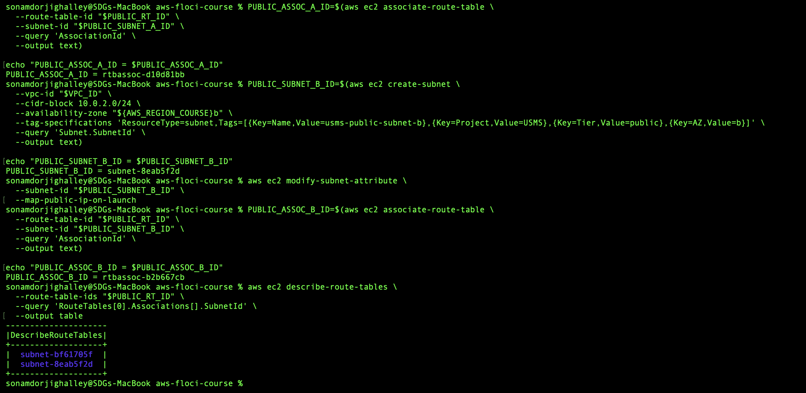

---

## Step 12 – Create and Associate the Private Route Table

A private route table named `usms-private-rt` was created.

### Commands Used

```bash
PRIVATE_RT_ID=$(aws ec2 create-route-table \
  --vpc-id "$VPC_ID" \
  --tag-specifications 'ResourceType=route-table,Tags=[{Key=Name,Value=usms-private-rt},{Key=Project,Value=USMS},{Key=Tier,Value=private}]' \
  --query 'RouteTable.RouteTableId' \
  --output text)

echo "PRIVATE_RT_ID = $PRIVATE_RT_ID"
```

Private subnet A was associated with this route table.

```bash
PRIVATE_ASSOC_A_ID=$(aws ec2 associate-route-table \
  --route-table-id "$PRIVATE_RT_ID" \
  --subnet-id "$PRIVATE_SUBNET_A_ID" \
  --query 'AssociationId' \
  --output text)

echo "PRIVATE_ASSOC_A_ID = $PRIVATE_ASSOC_A_ID"
```

At this stage, the private route table did not contain a default internet route.

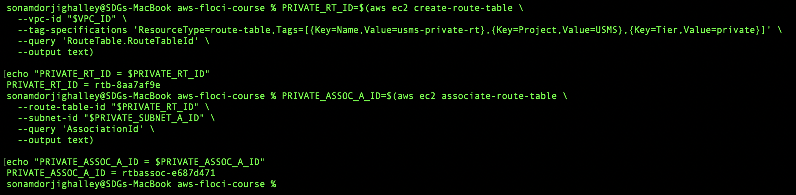

---

## Step 13 – Verify the Difference Between Public and Private Subnets

The effective route table of the public and private subnet was retrieved.

### Command Used

```bash
for s in "$PUBLIC_SUBNET_A_ID" "$PRIVATE_SUBNET_A_ID"; do

  name=$(aws ec2 describe-subnets \
    --subnet-ids "$s" \
    --query 'Subnets[0].Tags[?Key==`Name`]|[0].Value' \
    --output text)

  rt=$(aws ec2 describe-route-tables \
    --filters "Name=association.subnet-id,Values=$s" \
    --query 'RouteTables[0].RouteTableId' \
    --output text)

  igw=$(aws ec2 describe-route-tables \
    --route-table-ids "$rt" \
    --query 'RouteTables[0].Routes[?DestinationCidrBlock==`0.0.0.0/0`].GatewayId | [0]' \
    --output text)

  printf '%-24s subnet=%-26s rt=%-24s default-route-target=%s\n' \
    "$name" "$s" "$rt" "$igw"

done
```

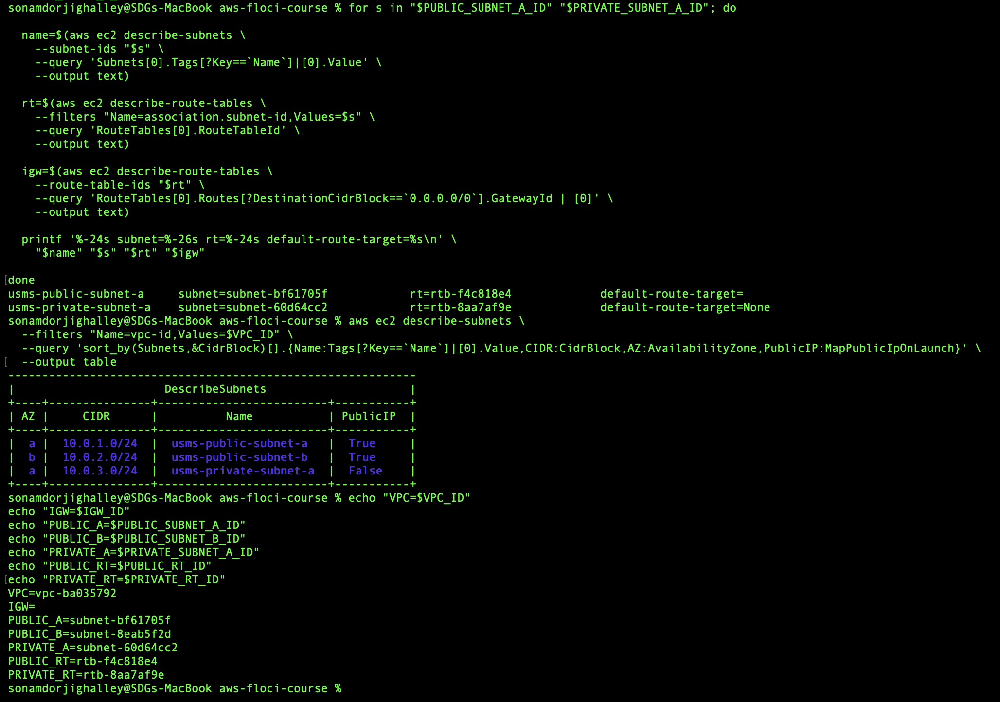


This demonstrated that a subnet becomes public because its route table contains a default route to an Internet Gateway.

The subnet name, tag and automatic public IPv4 assignment alone do not make a subnet public.


---

## Step 14 – Create the Application Security Group

A security group named `usms-app-sg` was created for the public application tier.

### Command Used

```bash
APP_SG_ID=$(aws ec2 create-security-group \
  --group-name usms-app-sg \
  --description "USMS application tier: HTTP/HTTPS from the internet, SSH from inside the VPC" \
  --vpc-id "$VPC_ID" \
  --tag-specifications 'ResourceType=security-group,Tags=[{Key=Name,Value=usms-app-sg},{Key=Project,Value=USMS},{Key=Tier,Value=app}]' \
  --query 'GroupId' \
  --output text)

echo "APP_SG_ID = $APP_SG_ID"
```

HTTP access was allowed.

```bash
aws ec2 authorize-security-group-ingress \
  --group-id "$APP_SG_ID" \
  --protocol tcp \
  --port 80 \
  --cidr 0.0.0.0/0
```

SSH access was restricted to the VPC.

```bash
aws ec2 authorize-security-group-ingress \
  --group-id "$APP_SG_ID" \
  --protocol tcp \
  --port 22 \
  --cidr 10.0.0.0/16
```

HTTPS access was also added.

```bash
aws ec2 authorize-security-group-ingress \
  --group-id "$APP_SG_ID" \
  --ip-permissions 'IpProtocol=tcp,FromPort=443,ToPort=443,IpRanges=[{CidrIp=0.0.0.0/0,Description="HTTPS access to USMS web tier"}]'
```

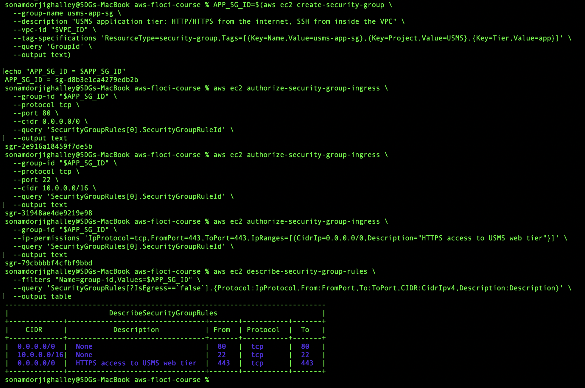

---

## Step 15 – Create the Database Security Group

A separate security group named `usms-db-sg` was created for the data tier.

### Command Used

```bash
DB_SG_ID=$(aws ec2 create-security-group \
  --group-name usms-db-sg \
  --description "USMS data tier: PostgreSQL from the application tier only" \
  --vpc-id "$VPC_ID" \
  --tag-specifications 'ResourceType=security-group,Tags=[{Key=Name,Value=usms-db-sg},{Key=Project,Value=USMS},{Key=Tier,Value=data}]' \
  --query 'GroupId' \
  --output text)

echo "DB_SG_ID = $DB_SG_ID"
```

The database ingress rule was stored in a JSON file.

```bash
mkdir -p policies

cat > policies/usms-db-sg-ingress.json << EOF
[
  {
    "IpProtocol": "tcp",
    "FromPort": 5432,
    "ToPort": 5432,
    "UserIdGroupPairs": [
      {
        "GroupId": "$APP_SG_ID",
        "Description": "PostgreSQL from the USMS application tier"
      }
    ]
  }
]
EOF
```

The rule was applied.

```bash
aws ec2 authorize-security-group-ingress \
  --group-id "$DB_SG_ID" \
  --ip-permissions file://policies/usms-db-sg-ingress.json
```

Verification:

```bash
aws ec2 describe-security-groups \
  --group-ids "$DB_SG_ID" \
  --query 'SecurityGroups[0].IpPermissions[].{Protocol:IpProtocol,From:FromPort,To:ToPort,SourceSG:UserIdGroupPairs[0].GroupId,SourceCIDR:IpRanges[0].CidrIp}' \
  --output table
```

The result showed:

```text
Port        5432
SourceSG    sg-...
SourceCIDR  None
```

This demonstrated that PostgreSQL access was controlled using the application security group's identity instead of a fixed subnet CIDR.

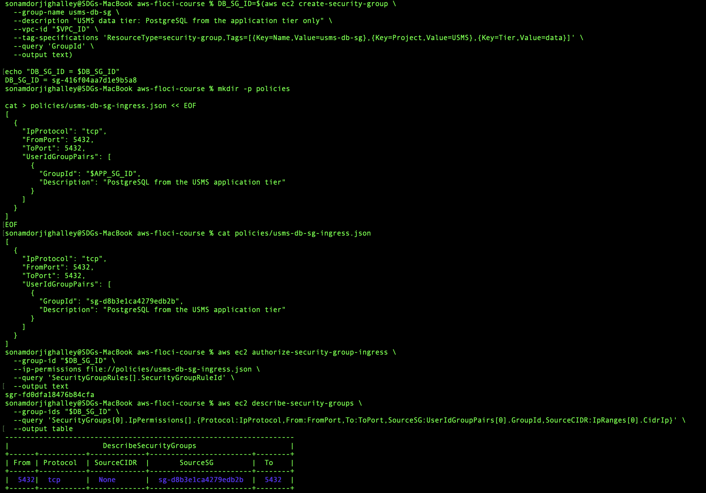


---

## Step 16 – Verify Security Groups

The security groups in the VPC were listed.

### Command Used

```bash
aws ec2 describe-security-groups \
  --filters "Name=vpc-id,Values=$VPC_ID" \
  --query 'SecurityGroups[].{Name:GroupName,Id:GroupId,Inbound:length(IpPermissions),Outbound:length(IpPermissionsEgress)}' \
  --output table
```

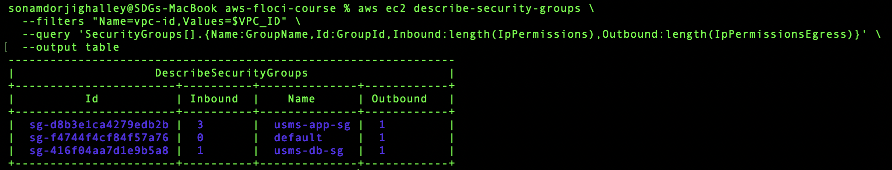


The default security group exists automatically in every VPC.

Security groups are stateful, which means response traffic for an established connection is automatically allowed.

---

## Step 17 – Create a Private Network ACL

The default NACL was inspected before creating a custom one.

A new Network ACL named `usms-private-nacl` was then created.

### Command Used

```bash
PRIVATE_NACL_ID=$(aws ec2 create-network-acl \
  --vpc-id "$VPC_ID" \
  --tag-specifications 'ResourceType=network-acl,Tags=[{Key=Name,Value=usms-private-nacl},{Key=Project,Value=USMS},{Key=Tier,Value=private}]' \
  --query 'NetworkAcl.NetworkAclId' \
  --output text)

echo "PRIVATE_NACL_ID = $PRIVATE_NACL_ID"
```

Inbound PostgreSQL traffic was allowed.

```bash
aws ec2 create-network-acl-entry \
  --network-acl-id "$PRIVATE_NACL_ID" \
  --rule-number 100 \
  --protocol tcp \
  --rule-action allow \
  --ingress \
  --cidr-block 10.0.0.0/16 \
  --port-range From=5432,To=5432
```

Inbound ephemeral return traffic was allowed.

```bash
aws ec2 create-network-acl-entry \
  --network-acl-id "$PRIVATE_NACL_ID" \
  --rule-number 110 \
  --protocol tcp \
  --rule-action allow \
  --ingress \
  --cidr-block 0.0.0.0/0 \
  --port-range From=1024,To=65535
```

Outbound return traffic to the application tier was allowed.

```bash
aws ec2 create-network-acl-entry \
  --network-acl-id "$PRIVATE_NACL_ID" \
  --rule-number 100 \
  --protocol tcp \
  --rule-action allow \
  --egress \
  --cidr-block 10.0.0.0/16 \
  --port-range From=1024,To=65535
```

Outbound HTTPS traffic was permitted.

```bash
aws ec2 create-network-acl-entry \
  --network-acl-id "$PRIVATE_NACL_ID" \
  --rule-number 110 \
  --protocol tcp \
  --rule-action allow \
  --egress \
  --cidr-block 0.0.0.0/0 \
  --port-range From=443,To=443
```
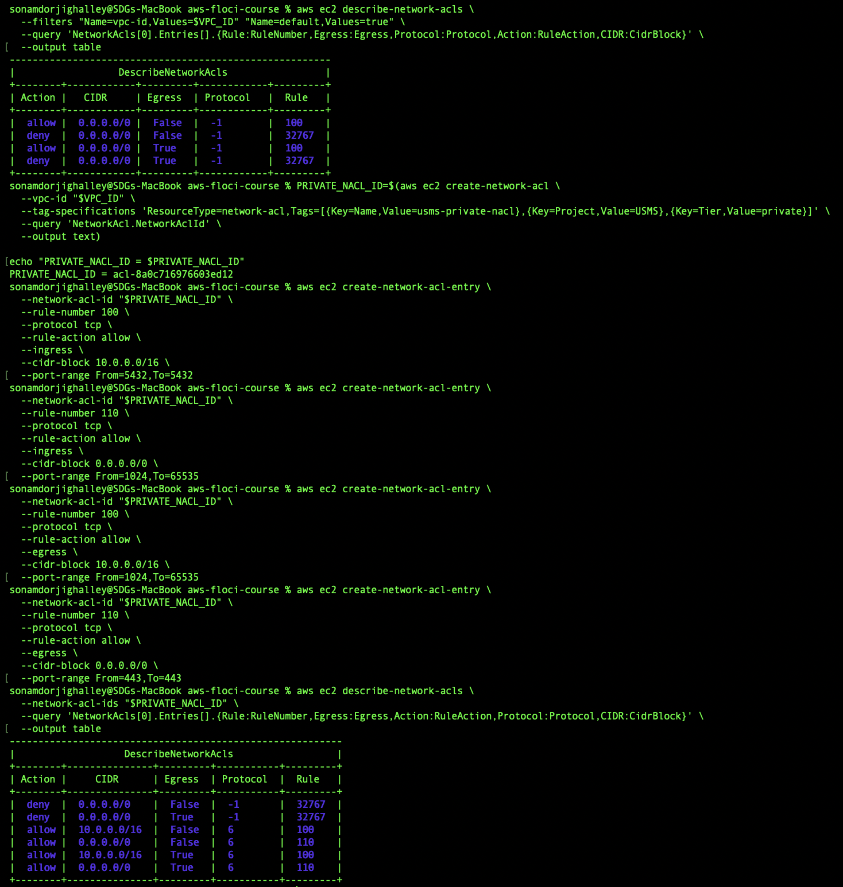


Because Network ACLs are stateless, both directions of communication must be explicitly considered.

---

## Step 18 – Associate the Private NACL with the Private Subnet

The existing NACL association was identified.

```bash
NACL_ASSOC_ID=$(aws ec2 describe-network-acls \
  --filters "Name=association.subnet-id,Values=$PRIVATE_SUBNET_A_ID" \
  --query 'NetworkAcls[0].Associations[0].NetworkAclAssociationId' \
  --output text)
```

The association was replaced.

```bash
aws ec2 replace-network-acl-association \
  --association-id "$NACL_ASSOC_ID" \
  --network-acl-id "$PRIVATE_NACL_ID" \
  --query 'NewAssociationId' \
  --output text
```

Verification:

```bash
aws ec2 describe-network-acls \
  --filters "Name=association.subnet-id,Values=$PRIVATE_SUBNET_A_ID" \
  --query 'NetworkAcls[0].{Id:NetworkAclId,Default:IsDefault,Name:Tags[?Key==`Name`]|[0].Value}' \
  --output table
```


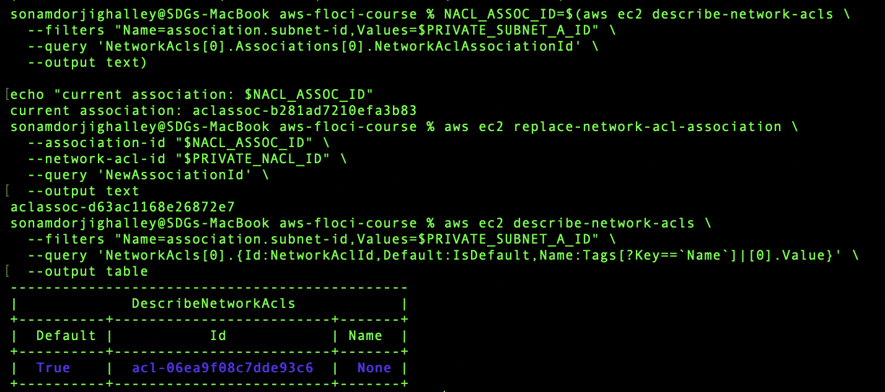


---

## Step 19 – Create the NAT Gateway

An Elastic IP was allocated.

### Command Used

```bash
NAT_EIP_ALLOC_ID=$(aws ec2 allocate-address \
  --domain vpc \
  --tag-specifications 'ResourceType=elastic-ip,Tags=[{Key=Name,Value=usms-nat-eip},{Key=Project,Value=USMS}]' \
  --query 'AllocationId' \
  --output text)

echo "NAT_EIP_ALLOC_ID = $NAT_EIP_ALLOC_ID"
```

A NAT Gateway was created inside public subnet A.

```bash
NAT_GW_ID=$(aws ec2 create-nat-gateway \
  --subnet-id "$PUBLIC_SUBNET_A_ID" \
  --allocation-id "$NAT_EIP_ALLOC_ID" \
  --tag-specifications 'ResourceType=natgateway,Tags=[{Key=Name,Value=usms-nat},{Key=Project,Value=USMS}]' \
  --query 'NatGateway.NatGatewayId' \
  --output text)

echo "NAT_GW_ID = $NAT_GW_ID"
```

The NAT Gateway state was checked.

```bash
aws ec2 wait nat-gateway-available \
  --nat-gateway-ids "$NAT_GW_ID" \
  && echo "NAT gateway available"
```

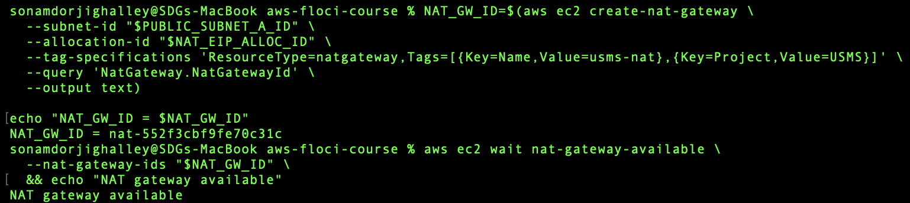

The NAT Gateway provides outbound connectivity for the private tier while preventing direct inbound internet connections.

---

## Step 20 – Point the Private Route Table to the NAT Gateway

A default route was added to the private route table.

### Command Used

```bash
aws ec2 create-route \
  --route-table-id "$PRIVATE_RT_ID" \
  --destination-cidr-block 0.0.0.0/0 \
  --nat-gateway-id "$NAT_GW_ID"
```

Verification:

```bash
aws ec2 describe-route-tables \
  --route-table-ids "$PRIVATE_RT_ID" \
  --query 'RouteTables[0].Routes[].{Destination:DestinationCidrBlock,Gateway:GatewayId,NAT:NatGatewayId,State:State}' \
  --output table
```

The expected routes were:

```text
10.0.0.0/16 -> local
0.0.0.0/0   -> nat-...
```

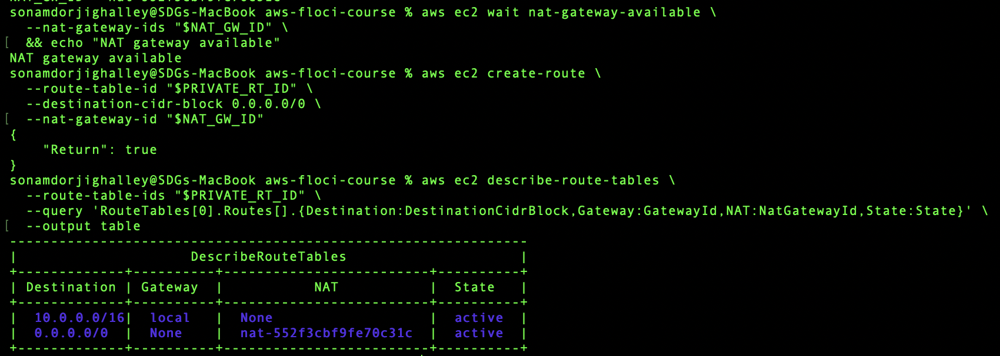

It was important that the private default route pointed to a NAT Gateway rather than an Internet Gateway.

---

## Step 21 – Create the S3 Gateway VPC Endpoint

An Amazon S3 Gateway Endpoint named `usms-s3-endpoint` was created.

### Command Used

```bash
S3_ENDPOINT_ID=$(aws ec2 create-vpc-endpoint \
  --vpc-id "$VPC_ID" \
  --service-name "com.amazonaws.${AWS_REGION_COURSE}.s3" \
  --vpc-endpoint-type Gateway \
  --route-table-ids "$PRIVATE_RT_ID" \
  --tag-specifications 'ResourceType=vpc-endpoint,Tags=[{Key=Name,Value=usms-s3-endpoint},{Key=Project,Value=USMS}]' \
  --query 'VpcEndpoint.VpcEndpointId' \
  --output text)

echo "S3_ENDPOINT_ID = $S3_ENDPOINT_ID"
```

The endpoint was verified.

```bash
aws ec2 describe-vpc-endpoints \
  --vpc-endpoint-ids "$S3_ENDPOINT_ID" \
  --query 'VpcEndpoints[0].{Id:VpcEndpointId,Service:ServiceName,Type:VpcEndpointType,State:State,RouteTables:RouteTableIds}' \
  --output table
```

The private route table was also checked.

```bash
aws ec2 describe-route-tables \
  --route-table-ids "$PRIVATE_RT_ID" \
  --query 'RouteTables[0].Routes[].{Destination:DestinationCidrBlock,PrefixList:DestinationPrefixListId,Gateway:GatewayId,NAT:NatGatewayId}' \
  --output table
```
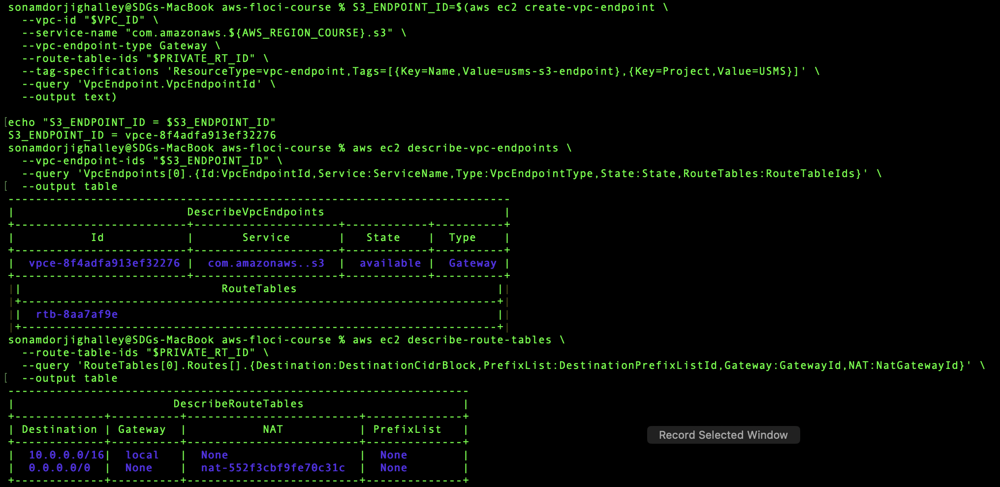

Some Floci builds may create the endpoint correctly but may not display the expected S3 prefix-list route. This is a limitation of the emulator.


---

## Step 22 – Audit Resource Tags

The resources created during the practical were audited using the `Project=USMS` tag.

### Command Used

```bash
aws ec2 describe-tags \
  --filters "Name=tag:Project,Values=USMS" \
  --query 'sort_by(Tags[?Key==`Name`], &Value)[].{Type:ResourceType,Name:Value,Id:ResourceId}' \
  --output table
```

The audit included resources such as:

```text
usms-vpc
usms-igw
usms-public-subnet-a
usms-public-subnet-b
usms-private-subnet-a
usms-public-rt
usms-private-rt
usms-app-sg
usms-db-sg
usms-private-nacl
usms-nat
usms-nat-eip
usms-s3-endpoint
```

A subnet inventory was also generated.

```bash
aws ec2 describe-subnets \
  --filters "Name=vpc-id,Values=$VPC_ID" \
  --query 'sort_by(Subnets, &Tags[?Key==`Tier`]|[0].Value)[].{Name:Tags[?Key==`Name`]|[0].Value,CIDR:CidrBlock,AZ:AvailabilityZone,Tier:Tags[?Key==`Tier`]|[0].Value}' \
  --output table | tee outputs/lab-02-subnet-inventory.txt
```

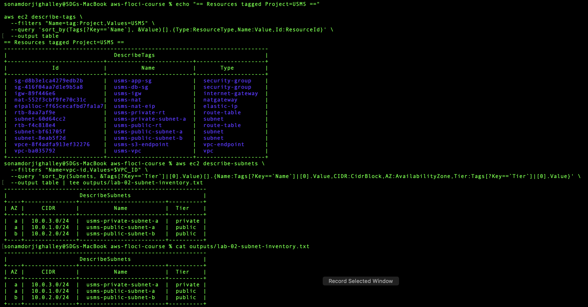

---

## Step 23 – Prove Persistence Across a Floci Restart

The state of the VPC was recorded before restarting Floci.

### Commands Used Before Restart

```bash
aws ec2 describe-vpcs \
  --vpc-ids "$VPC_ID" \
  --query 'Vpcs[0].VpcId' \
  --output text > outputs/lab-02-pre-restart.txt
```

```bash
aws ec2 describe-subnets \
  --filters "Name=vpc-id,Values=$VPC_ID" \
  --query 'length(Subnets)' \
  --output text >> outputs/lab-02-pre-restart.txt
```

```bash
aws ec2 describe-security-groups \
  --filters "Name=vpc-id,Values=$VPC_ID" \
  --query 'length(SecurityGroups)' \
  --output text >> outputs/lab-02-pre-restart.txt
```

Floci was then stopped and restarted.

```bash
./scripts/setup/floci-down.sh
sleep 3

./scripts/setup/floci-up.sh
sleep 5
```

The course environment was reloaded.

```bash
source configs/course.env
```

The VPC was rediscovered using its tag rather than the existing shell variable.

```bash
VPC_ID=$(aws ec2 describe-vpcs \
  --filters "Name=tag:Name,Values=usms-vpc" \
  --query 'Vpcs[0].VpcId' \
  --output text)
```

The post-restart values were recorded.

```bash
{
  echo "$VPC_ID"

  aws ec2 describe-subnets \
    --filters "Name=vpc-id,Values=$VPC_ID" \
    --query 'length(Subnets)' \
    --output text

  aws ec2 describe-security-groups \
    --filters "Name=vpc-id,Values=$VPC_ID" \
    --query 'length(SecurityGroups)' \
    --output text

} > outputs/lab-02-post-restart.txt
```

The files were compared.

```bash
diff outputs/lab-02-pre-restart.txt \
     outputs/lab-02-post-restart.txt \
&& echo "PERSISTENCE PROVEN: VPC id, subnet count and security group count all unchanged" \
|| echo "PERSISTENCE FAILED: run ./scripts/utilities/floci-storage-check.sh"
```

The successful output was:

```text
PERSISTENCE PROVEN: VPC id, subnet count and security group count all unchanged
```

This proved that the VPC and its dependent resources survived the Floci restart.

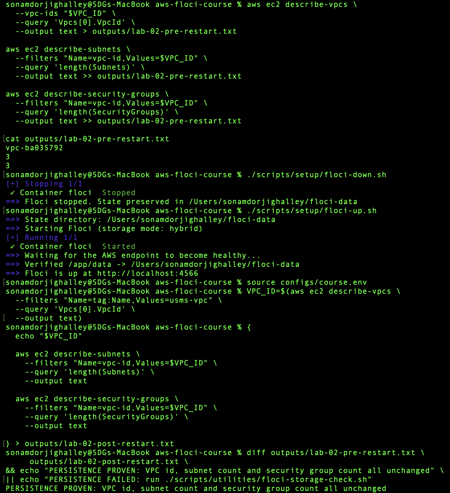

---

## Step 24 – Create `configs/lab-02.env`

All important network resource identifiers were stored in:

```text
configs/lab-02.env
```

The file contains values including:

```text
USMS_VPC_ID
USMS_VPC_CIDR
USMS_IGW_ID
USMS_PUBLIC_SUBNET_A
USMS_PUBLIC_SUBNET_B
USMS_PRIVATE_SUBNET_A
USMS_PRIVATE_SUBNET_B
USMS_PUBLIC_RT
USMS_PRIVATE_RT
USMS_APP_SG
USMS_DB_SG
USMS_PRIVATE_NACL
USMS_NAT_GW
USMS_NAT_EIP_ALLOC
USMS_S3_ENDPOINT
USMS_AZ_A
USMS_AZ_B
```

The environment file was checked for empty or `None` values.

```bash
grep -n 'export .*=$\|None' configs/lab-02.env \
|| echo "all values populated"
```

The expected output after completing all required resources was:

```text
all values populated
```

The number of exported values was checked.

```bash
grep -c '^export' configs/lab-02.env
```

Expected:

```text
17
```

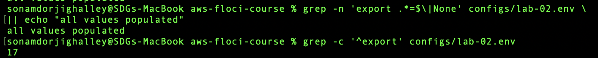

---

## Step 25 – Commit the Work to Git

The repository was checked before staging files.

### Commands Used

```bash
git status --short
```

The output directory was confirmed to be ignored.

```bash
git check-ignore -v outputs/lab-02-assumed-role.json
```

Appropriate Lab 02 files were staged.

```bash
git add \
  labs/lab-02-vpc/ \
  configs/lab-02.env \
  policies/usms-db-sg-ingress.json \
  scripts/utilities/verify-lab-02.sh \
  scripts/cleanup/lab-02-cleanup.sh
```

The work was committed.

```bash
git commit -m "Lab 02: USMS VPC, subnets, routing, security groups, NACL, NAT and S3 endpoint"
```

The Git history was checked.

```bash
git log --oneline -3
```

This ensured that the Lab 02 configuration was stored under version control without committing temporary credentials or sensitive output files.

---

# 7. Final Verification

The Lab 02 verification script was executed after completing the required resources.

### Command Used

```bash
./scripts/utilities/verify-lab-02.sh
```

The expected final result was:

```text
PASS=33 FAIL=0
```

The script verifies:

- Floci container status;
- persistent storage;
- AWS CLI connectivity;
- correct account ID;
- Lab 01 dependencies;
- VPC configuration;
- DNS settings;
- Internet Gateway attachment;
- public and private subnet configuration;
- route-table associations;
- security groups;
- database security-group reference;
- Network ACL association;
- S3 VPC Endpoint;
- resource tags;
- environment files; and
- Git security hygiene.

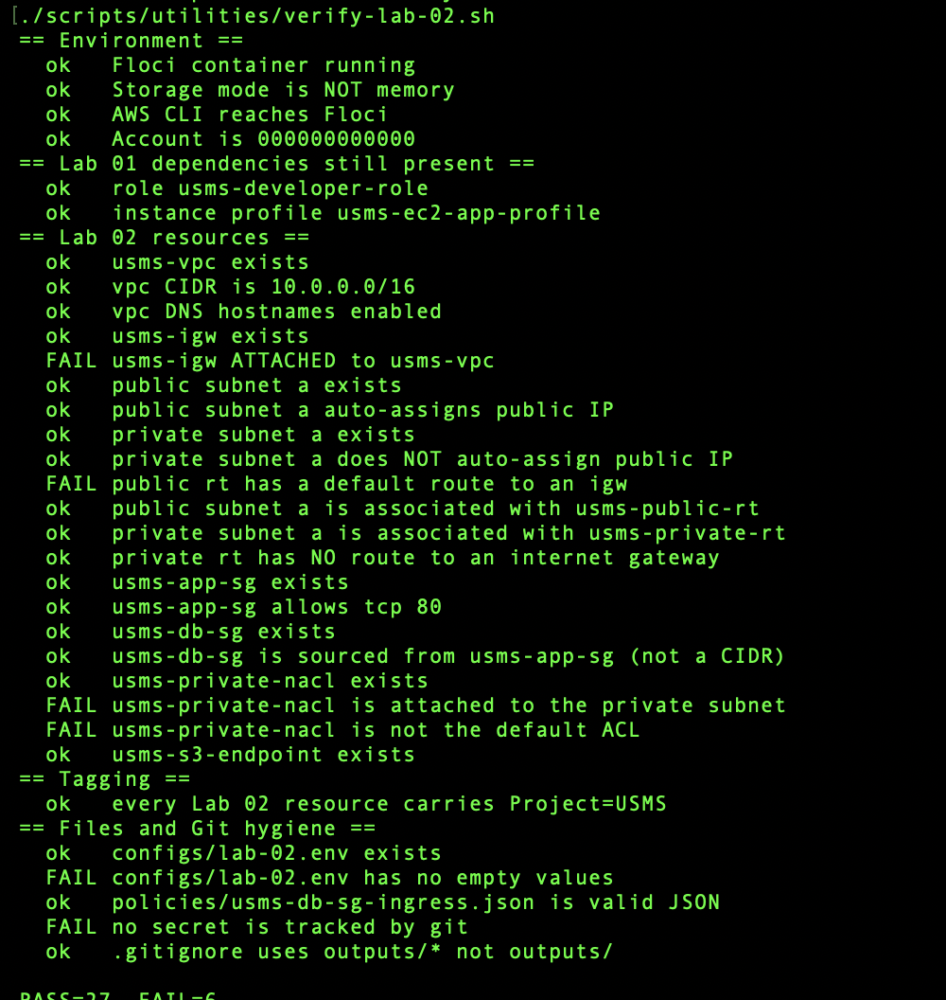

---

# 8. Results

The practical successfully created a multi-tier networking environment for the University Student Management System.

The main results were:

1. A VPC named `usms-vpc` was created with CIDR `10.0.0.0/16`.

2. DNS support and DNS hostnames were enabled.

3. An Internet Gateway named `usms-igw` was created and attached to the VPC.

4. Public and private subnets were created across multiple Availability Zones.

5. Public subnets were configured for automatic public IPv4 assignment.

6. A public route table was created with:

```text
0.0.0.0/0 -> usms-igw
```

7. A separate private route table was created.

8. Public and private subnet routing was verified through the AWS API.

9. `usms-app-sg` was created for the application tier.

10. `usms-db-sg` was created for the database tier.

11. PostgreSQL TCP port 5432 was allowed using a security-group reference from `usms-app-sg`.

12. A custom Network ACL named `usms-private-nacl` was created.

13. A NAT Gateway named `usms-nat` was placed in public subnet A.

14. The private route table was updated with:

```text
0.0.0.0/0 -> usms-nat
```

15. An S3 Gateway Endpoint named `usms-s3-endpoint` was created.

16. Resource tagging was audited using `Project=USMS`.

17. The network configuration successfully survived a Floci restart.

18. All important network resource IDs were recorded in `configs/lab-02.env`.

19. The final verification script was used to confirm the completed configuration.

---

# 9. Discussion

One of the most important concepts demonstrated by this practical was that a subnet is not public merely because it is named or tagged as public.

The defining network characteristic is its effective route table.

The public subnet contained:

```text
0.0.0.0/0 -> Internet Gateway
```

whereas the private subnet did not initially have a default route.

Checkpoint 5 demonstrated this difference directly through API queries.

Another important concept was the difference between security groups and Network ACLs.

Security groups are:

- stateful;
- applied to instances or network interfaces;
- allow-only; and
- capable of referencing other security groups.

Network ACLs are:

- stateless;
- applied at the subnet level;
- capable of both allow and deny rules; and
- evaluated according to rule number.

Because Network ACLs are stateless, return traffic must be explicitly permitted. This explains why ephemeral-port rules were required.

The database security-group configuration demonstrated the advantage of using a group reference rather than a fixed CIDR range.

Instead of defining the database rule as:

```text
TCP 5432 from 10.0.1.0/24
```

the configuration used:

```text
TCP 5432 from usms-app-sg
```

This allows the application tier to move or scale across multiple subnets without requiring the database security rule to be rewritten.

The NAT Gateway provided outbound connectivity from the private tier without creating a direct Internet Gateway route.

The S3 Gateway Endpoint provided a service-specific path from the private network to Amazon S3.

Finally, the persistence test demonstrated an important infrastructure-management principle. Simply receiving a successful response when a resource is created does not prove that it will survive a restart. The network was therefore rediscovered through API queries after the Floci restart.

---

# 10. Challenges / Limitations

Several challenges and limitations were identified during the practical.

## 10.1 Shell Variables

Resource identifiers were initially stored in Bash variables.

If a new terminal is opened, these variables may no longer exist.

For this reason, resource tags were used to rediscover resources and the final identifiers were stored in:

```text
configs/lab-02.env
```

## 10.2 NAT Gateway Waiter

The NAT Gateway waiter may behave differently in Floci compared with real AWS.

If the waiter does not complete, manual polling can be used to check the NAT Gateway state.

## 10.3 S3 Gateway Endpoint Route

Some Floci builds may successfully create an S3 Gateway Endpoint but not display the expected S3 prefix-list route inside the route table.

This is a limitation of the emulator and does not represent normal behaviour on real AWS.

## 10.4 Security-Group Enforcement

Floci stores security-group rules but does not fully enforce them against real packet traffic.

Therefore, security-group correctness was verified by reading the configured rules back through the API.

## 10.5 Network ACL Enforcement

Similarly, Floci stores Network ACL rules but does not provide a complete network data plane in which the effect of those rules can be observed through actual packet traffic.

## 10.6 NAT Translation

Floci represents a NAT Gateway as an AWS-compatible object, but it does not provide the complete managed NAT translation service available in real AWS.

The architectural design can therefore be configured and inspected even though actual NAT packet translation is not demonstrated.

---

# 11. Conclusion

This practical successfully demonstrated the design and configuration of a multi-tier AWS Virtual Private Cloud network using the AWS CLI.

A custom VPC using CIDR `10.0.0.0/16` was created and divided into public and private subnets across multiple Availability Zones.

An Internet Gateway and public route table provided internet connectivity for the application tier.

The private data tier was protected from direct internet access and was configured to use a NAT Gateway for controlled outbound connections.

Security was implemented using both security groups and Network ACLs.

The application security group allowed HTTP and HTTPS access, while the database security group restricted PostgreSQL connectivity to resources belonging to the application security group.

The custom Network ACL provided an additional subnet-level protection layer.

An S3 Gateway VPC Endpoint was also created to support service-specific connectivity from the private network.

The practical further demonstrated the importance of:

- CIDR planning;
- route-table configuration;
- resource tagging;
- security-group references;
- stateful and stateless firewall behaviour;
- controlled private-tier internet access;
- AWS CLI filtering;
- persistent resource configuration; and
- verification through API read-back.

The persistence test confirmed that the USMS network survived a restart of the Floci environment, while the final resource identifiers were stored in `configs/lab-02.env` for use by later practicals.

Overall, the practical provided a strong foundation in AWS VPC architecture and prepared the USMS network for the deployment of EC2, storage and database resources in subsequent labs.

---

### AWS lab 2 VPC 

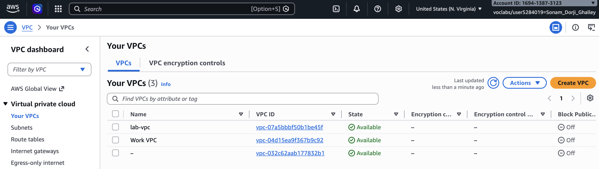

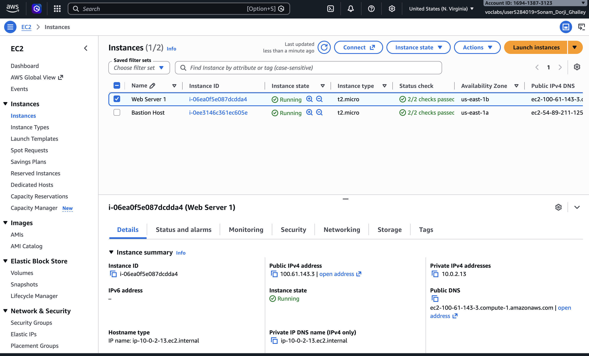
