# Lab 02 – Independent Exercises

## Virtual Private Cloud and Networking

This document records the commands, outputs, verification results and design decisions for the five independent exercises completed as part of **Lab 02 – Virtual Private Cloud and Networking**.

---

# Exercise 1 – Basic: A Third Public Subnet

## Objective

The objective of this exercise was to create a third public subnet named `usms-public-subnet-c` in Availability Zone `us-east-1c` with CIDR block `10.0.5.0/24`.

The subnet was required to:

- belong to `usms-vpc`;
- use CIDR `10.0.5.0/24`;
- be located in `us-east-1c`;
- automatically assign public IPv4 addresses;
- use the existing `usms-public-rt` route table;
- use consistent USMS resource tags; and
- capture the subnet ID automatically rather than copying it manually.

---

## Commands

First, the existing Lab 02 environment was loaded.

```bash
cd ~/aws-floci-course

source configs/course.env
source configs/lab-01.env
source configs/lab-02.env
```

The existing VPC and public route-table IDs were loaded:

```bash
VPC_ID="$USMS_VPC_ID"
PUBLIC_RT_ID="$USMS_PUBLIC_RT"
```

The third public subnet was then created.

```bash
PUBLIC_SUBNET_C_ID=$(aws ec2 create-subnet \
  --vpc-id "$VPC_ID" \
  --cidr-block 10.0.5.0/24 \
  --availability-zone "${AWS_REGION_COURSE}c" \
  --tag-specifications 'ResourceType=subnet,Tags=[{Key=Name,Value=usms-public-subnet-c},{Key=Project,Value=USMS},{Key=Tier,Value=public},{Key=AZ,Value=c}]' \
  --query 'Subnet.SubnetId' \
  --output text)

echo "PUBLIC_SUBNET_C_ID=$PUBLIC_SUBNET_C_ID"
```

## Output

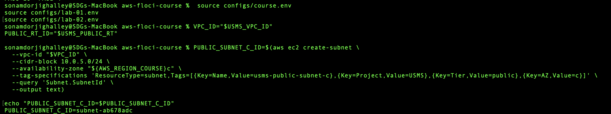

Automatic public IPv4 assignment was enabled:

```bash
aws ec2 modify-subnet-attribute \
  --subnet-id "$PUBLIC_SUBNET_C_ID" \
  --map-public-ip-on-launch
```

The new subnet was associated with `usms-public-rt`:

```bash
PUBLIC_ASSOC_C_ID=$(aws ec2 associate-route-table \
  --route-table-id "$PUBLIC_RT_ID" \
  --subnet-id "$PUBLIC_SUBNET_C_ID" \
  --query 'AssociationId' \
  --output text)

echo "PUBLIC_ASSOC_C_ID=$PUBLIC_ASSOC_C_ID"
```

## Output

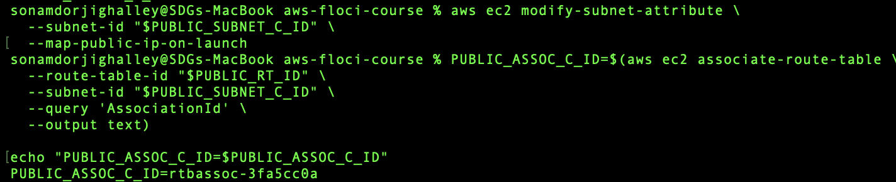


## Verification

The subnet configuration was verified using:

```bash
aws ec2 describe-subnets \
  --subnet-ids "$PUBLIC_SUBNET_C_ID" \
  --query 'Subnets[0].{Name:Tags[?Key==`Name`]|[0].Value,CIDR:CidrBlock,AZ:AvailabilityZone,PublicIP:MapPublicIpOnLaunch,State:State}' \
  --output table
```

## Output
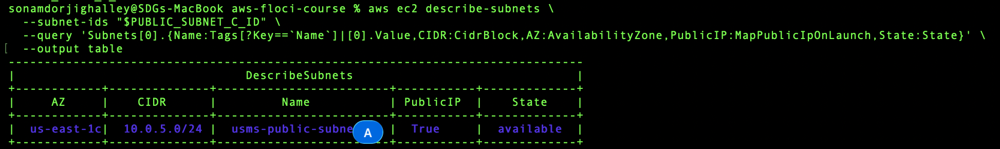


The expected properties were:

```text
Name       = usms-public-subnet-c
CIDR       = 10.0.5.0/24
AZ         = us-east-1c
PublicIP   = True
State      = available
```

The route-table association was also verified:

```bash
aws ec2 describe-route-tables \
  --route-table-ids "$PUBLIC_RT_ID" \
  --query 'RouteTables[0].Associations[].SubnetId' \
  --output table
```

## Output

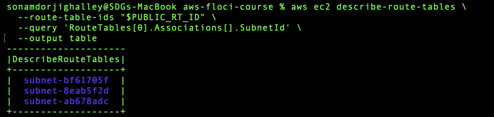

---

## Result

`usms-public-subnet-c` was successfully created in `us-east-1c` using CIDR `10.0.5.0/24`. Automatic public IPv4 assignment was enabled and the subnet was associated with `usms-public-rt`.

The subnet was created only as a practice resource and was not added to `configs/lab-02.env`. It was later removed as part of Exercise 4.

---

# Exercise 2 – Intermediate: A Bastion Security Group

## Objective

The objective of this exercise was to improve administrative SSH security by introducing a dedicated bastion security group.

A new security group named `usms-bastion-sg` was created. It permitted SSH only from one approved `/32` address.

The existing SSH rule on `usms-app-sg`, which originally allowed TCP port 22 from the whole `10.0.0.0/16` VPC range, was replaced with a security-group reference to `usms-bastion-sg`.

This provides more restrictive and identity-based administrative access.

---

## Commands

The Lab 02 configuration was loaded.

```bash
cd ~/aws-floci-course

source configs/course.env
source configs/lab-02.env

VPC_ID="$USMS_VPC_ID"
APP_SG_ID="$USMS_APP_SG"
```

The bastion security group was created.

```bash
BASTION_SG_ID=$(aws ec2 create-security-group \
  --group-name usms-bastion-sg \
  --description "USMS bastion host: restricted administrative SSH access" \
  --vpc-id "$VPC_ID" \
  --tag-specifications 'ResourceType=security-group,Tags=[{Key=Name,Value=usms-bastion-sg},{Key=Project,Value=USMS},{Key=Tier,Value=management}]' \https://file+.vscode-resource.vscode-cdn.net/Users/sonamdorjighalley/Desktop/SEM-7/DSO303/LAB/aws-floci-course/screenshots/lab_2/lab02-e6.png
  --query 'GroupId' \
  --output text)

echo "BASTION_SG_ID=$BASTION_SG_ID"
```

## Output
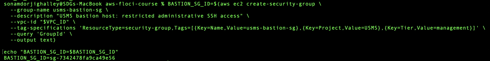


SSH access to the bastion was limited to the example administrative address `203.0.113.10/32`.

```bash
aws ec2 authorize-security-group-ingress \
  --group-id "$BASTION_SG_ID" \
  --ip-permissions '[
    {
      "IpProtocol":"tcp",
      "FromPort":22,
      "ToPort":22,
      "IpRanges":[
        {
          "CidrIp":"203.0.113.10/32",
          "Description":"Administrative SSH from approved external address"
        }
      ]
    }
  ]' \
  --query 'SecurityGroupRules[].SecurityGroupRuleId' \
  --output text
```

## Output

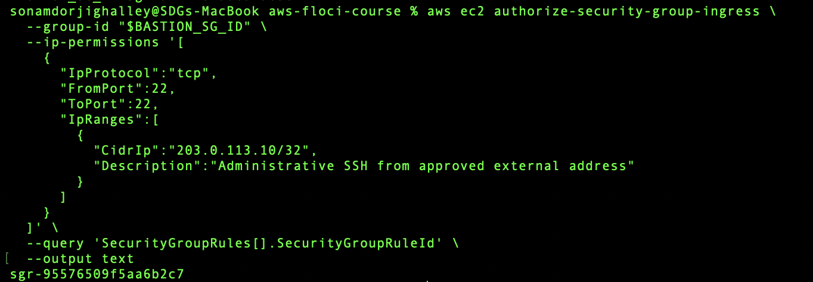

A new SSH rule was then added to `usms-app-sg`, referencing the bastion security group rather than a CIDR range.

```bash
aws ec2 authorize-security-group-ingress \
  --group-id "$APP_SG_ID" \
  --ip-permissions "[
    {
      \"IpProtocol\":\"tcp\",
      \"FromPort\":22,
      \"ToPort\":22,
      \"UserIdGroupPairs\":[
        {
          \"GroupId\":\"$BASTION_SG_ID\",
          \"Description\":\"SSH to USMS application servers from bastion hosts only\"
        }
      ]
    }
  ]" \
  --query 'SecurityGroupRules[].SecurityGroupRuleId' \
  --output text
```

## Output

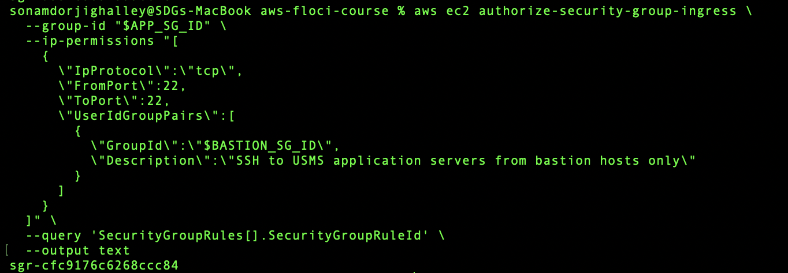

The old SSH rule that allowed `10.0.0.0/16` was identified:

```bash
OLD_SSH_RULE_ID=$(aws ec2 describe-security-group-rules \
  --filters "Name=group-id,Values=$APP_SG_ID" \
  --query 'SecurityGroupRules[?IsEgress==`false` && FromPort==`22` && CidrIpv4==`10.0.0.0/16`].SecurityGroupRuleId | [0]' \
  --output text)

echo "OLD_SSH_RULE_ID=$OLD_SSH_RULE_ID"
```

## Output

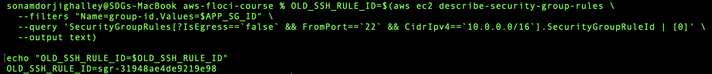

The old rule was removed.

```bash
aws ec2 revoke-security-group-ingress \
  --group-id "$APP_SG_ID" \
  --security-group-rule-ids "$OLD_SSH_RULE_ID"
```

## Output

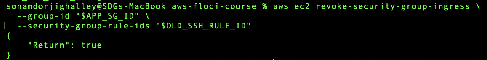


## Verification

The bastion security group was verified:

```bash
aws ec2 describe-security-group-rules \
  --filters "Name=group-id,Values=$BASTION_SG_ID" \
  --query 'SecurityGroupRules[?IsEgress==`false`].{Protocol:IpProtocol,Port:FromPort,CIDR:CidrIpv4,Description:Description}' \
  --output table
```

## Output

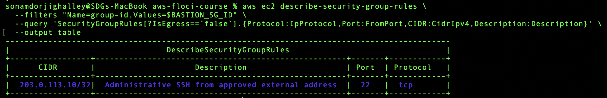

The SSH configuration of `usms-app-sg` was then verified:

```bash
aws ec2 describe-security-groups \
  --group-ids "$APP_SG_ID" \
  --query 'SecurityGroups[0].IpPermissions[?FromPort==`22`].{Protocol:IpProtocol,Port:FromPort,SourceSG:UserIdGroupPairs[0].GroupId,SourceCIDR:IpRanges[0].CidrIp}' \
  --output table
```

## Output

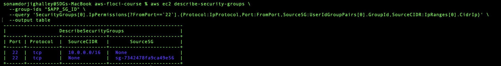

The final SSH rule showed the bastion group's ID as `SourceSG` rather than the original `10.0.0.0/16` CIDR.

---

## Result

A dedicated bastion security group was successfully created.

SSH access to the bastion was restricted to a single approved `/32` source, while SSH access to the USMS application servers was restricted to resources belonging to `usms-bastion-sg`.

This provides a more secure administrative access design than permitting SSH from the entire VPC.

---

# Exercise 3 – Problem Solving: Prove a Claim About the Network

## Objective

The objective of this exercise was to create a reusable Bash script named:

```text
scripts/utilities/lab-02-network-report.sh
```

The script classifies every subnet in `usms-vpc` as:

- `PUBLIC`;
- `PRIVATE`; or
- `ISOLATED`.

The classification must be based entirely on the subnet's effective route table.

The subnet name and `Tier` tag must not be used to determine whether the subnet is public or private.

---

## Create the Script

The following script was created:

```bash
cat > scripts/utilities/lab-02-network-report.sh << 'EOF'
#!/usr/bin/env bash

set -uo pipefail

REPO_ROOT="$(cd "$(dirname "${BASH_SOURCE[0]}")/../.." && pwd)"
cd "$REPO_ROOT"

source "$REPO_ROOT/configs/course.env"
source "$REPO_ROOT/configs/lab-02.env"

aws ec2 describe-subnets \
  --filters "Name=vpc-id,Values=$USMS_VPC_ID" \
  --query 'sort_by(Subnets,&CidrBlock)[].[SubnetId,CidrBlock,AvailabilityZone,Tags[?Key==`Name`]|[0].Value]' \
  --output text |
while read -r subnet_id cidr az name; do

    rt=$(aws ec2 describe-route-tables \
      --filters "Name=association.subnet-id,Values=$subnet_id" \
      --query 'RouteTables[0].RouteTableId' \
      --output text)

    # If no explicit route-table association exists,
    # use the VPC main route table.
    if [ "$rt" = "None" ] || [ -z "$rt" ]; then
        rt=$(aws ec2 describe-route-tables \
          --filters \
            "Name=vpc-id,Values=$USMS_VPC_ID" \
            "Name=association.main,Values=true" \
          --query 'RouteTables[0].RouteTableId' \
          --output text)
    fi

    igw=$(aws ec2 describe-route-tables \
      --route-table-ids "$rt" \
      --query 'RouteTables[0].Routes[?DestinationCidrBlock==`0.0.0.0/0`].GatewayId | [0]' \
      --output text)

    nat=$(aws ec2 describe-route-tables \
      --route-table-ids "$rt" \
      --query 'RouteTables[0].Routes[?DestinationCidrBlock==`0.0.0.0/0`].NatGatewayId | [0]' \
      --output text)

    if [[ "$igw" == igw-* ]]; then

        printf '%s %s %s PUBLIC via %s\n' \
          "$name" "$cidr" "$az" "$igw"

    elif [[ "$nat" == nat-* ]]; then

        printf '%s %s %s PRIVATE via %s\n' \
          "$name" "$cidr" "$az" "$nat"

    else

        printf '%s %s %s ISOLATED no default route\n' \
          "$name" "$cidr" "$az"

    fi

done
EOF
```

The script was made executable:

```bash
chmod +x scripts/utilities/lab-02-network-report.sh
```

---

##  Run from the Repository Root

```bash
cd ~/aws-floci-course

./scripts/utilities/lab-02-network-report.sh
```

## Output

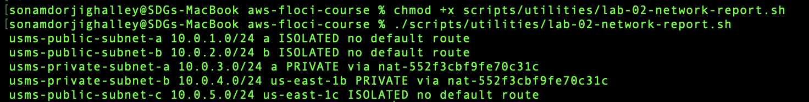

The output followed a format similar to:

```text
usms-public-subnet-a 10.0.1.0/24 us-east-1a PUBLIC via igw-...
usms-public-subnet-b 10.0.2.0/24 us-east-1b PUBLIC via igw-...
usms-public-subnet-c 10.0.5.0/24 us-east-1c PUBLIC via igw-...
usms-private-subnet-a 10.0.3.0/24 us-east-1a PRIVATE via nat-...
usms-private-subnet-b 10.0.4.0/24 us-east-1b PRIVATE via nat-...
```

The exact list depends on which exercise resources existed when the script was executed.

---


## How the Classification Works

The script checks the `0.0.0.0/0` route of the route table associated with each subnet.

If the default route points to an Internet Gateway:

```text
0.0.0.0/0 -> igw-...
```

the subnet is classified as:

```text
PUBLIC
```

If the default route points to a NAT Gateway:

```text
0.0.0.0/0 -> nat-...
```

the subnet is classified as:

```text
PRIVATE
```

If no default route exists, the subnet is classified as:

```text
ISOLATED
```

This ensures that the classification is based on routing behaviour rather than resource naming.

---

## Result

The Bash script successfully produced a route-based network report for all subnets in `usms-vpc`.

The script could be executed from different directories because it calculated the repository root from `${BASH_SOURCE[0]}` rather than assuming the current working directory.

No resource IDs were hard-coded.

---

# Exercise 4 – Challenge: Design and Defend

## Scenario

The USMS project is introducing an **exam-results service**.

The requirements are:

- the service must be accessible only by university staff on campus;
- the campus network uses `10.10.0.0/16`;
- campus users reach AWS through a VPN;
- traffic therefore arrives with campus source addresses;
- the service must read the transcripts database;
- the service must never be directly accessible from the public internet; and
- the service must be able to download operating-system and security updates.

The existing `usms-vpc` must be reused.

No additional VPC is required.

---

## 4.1 Proposed Subnet

The exam-results service should be deployed in the existing **private tier**.

I would deploy the service in:

```text
usms-private-subnet-b
10.0.4.0/24
us-east-1b
```

The private subnet is appropriate because it does not have a direct route to the Internet Gateway and does not automatically assign public IPv4 addresses.

This satisfies the requirement that the exam-results service must never be directly accessible from the public internet.

Outbound internet access for operating-system and security patches can still be provided through the NAT Gateway.

Because campus users reach AWS over a VPN and their original addresses remain within `10.10.0.0/16`, the VPC must also have an appropriate route for the campus network through the VPN path.

A route such as:

```text
10.10.0.0/16 -> VPN connection
```

would therefore be required in the appropriate private route table or learned through the applicable VPN route-propagation mechanism.

---

## 4.2 Security Group Design

A new security group named:

```text
usms-exam-sg
```

was designed for the exam-results service.

### Inbound Rule

| Protocol | Port | Source | Purpose |
|---|---:|---|---|
| TCP | 443 | `10.10.0.0/16` | HTTPS access from university campus |

### Justification

Only HTTPS traffic from the university campus network is required.

Therefore, the service should not contain an inbound rule from:

```text
0.0.0.0/0
```

No public HTTP or SSH access is required by the scenario.

---

## 4.3 Database Security Group Change

The exam service needs to read the transcripts database.

Therefore, `usms-db-sg` requires an additional inbound rule:

| Protocol | Port | Source | Purpose |
|---|---:|---|---|
| TCP | 5432 | `usms-exam-sg` | PostgreSQL from exam-results service |

### Justification

The database should trust the security identity of the exam-results service rather than an entire subnet address range.

This also keeps the existing application-tier rule unchanged:

```text
TCP 5432 from usms-app-sg
```

---

# Implemented Security Group Changes

Only the security-group portion of the proposed architecture was implemented, as required by the exercise.

The existing environment was loaded:

```bash
cd ~/aws-floci-course

source configs/course.env
source configs/lab-02.env

VPC_ID="$USMS_VPC_ID"
DB_SG_ID="$USMS_DB_SG"
```

The new exam security group was created.

```bash
EXAM_SG_ID=$(aws ec2 create-security-group \
  --group-name usms-exam-sg \
  --description "USMS exam-results service: campus HTTPS access only" \
  --vpc-id "$VPC_ID" \
  --tag-specifications 'ResourceType=security-group,Tags=[{Key=Name,Value=usms-exam-sg},{Key=Project,Value=USMS},{Key=Tier,Value=exam}]' \
  --query 'GroupId' \
  --output text)

echo "EXAM_SG_ID=$EXAM_SG_ID"
```

## Output

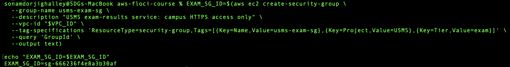


HTTPS access from campus was allowed:

```bash
aws ec2 authorize-security-group-ingress \
  --group-id "$EXAM_SG_ID" \
  --ip-permissions '[
    {
      "IpProtocol":"tcp",
      "FromPort":443,
      "ToPort":443,
      "IpRanges":[
        {
          "CidrIp":"10.10.0.0/16",
          "Description":"HTTPS access from university campus over VPN"
        }
      ]
    }
  ]' \
  --query 'SecurityGroupRules[].SecurityGroupRuleId' \
  --output text
```

## Output
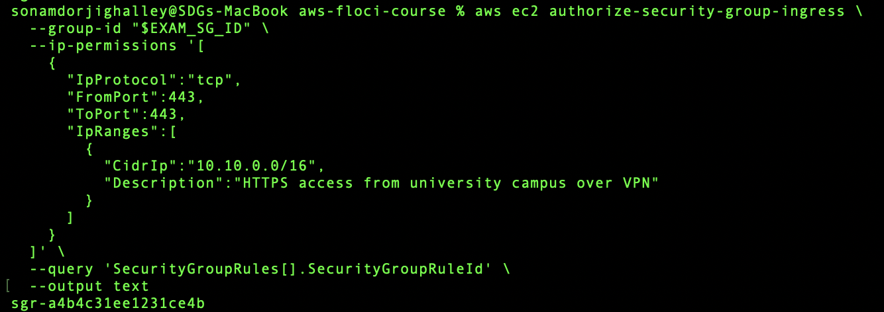

PostgreSQL access from the exam service was added to `usms-db-sg`.

```bash
aws ec2 authorize-security-group-ingress \
  --group-id "$DB_SG_ID" \
  --ip-permissions "[
    {
      \"IpProtocol\":\"tcp\",
      \"FromPort\":5432,
      \"ToPort\":5432,
      \"UserIdGroupPairs\":[
        {
          \"GroupId\":\"$EXAM_SG_ID\",
          \"Description\":\"PostgreSQL access from USMS exam-results service\"
        }
      ]
    }
  ]" \
  --query 'SecurityGroupRules[].SecurityGroupRuleId' \
  --output text
```

## Output

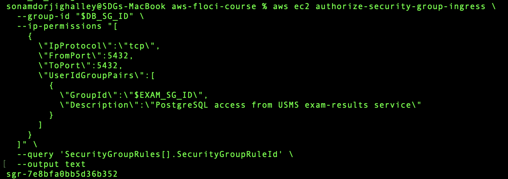

---

## Verification of usms-exam-sg

```bash
aws ec2 describe-security-groups \
  --group-ids "$EXAM_SG_ID" \
  --query 'SecurityGroups[0].IpPermissions[].{Protocol:IpProtocol,From:FromPort,To:ToPort,CIDR:IpRanges[0].CidrIp,Description:IpRanges[0].Description}' \
  --output table
```

## Output

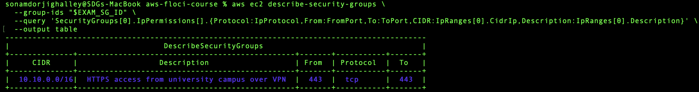

The expected rule was:

```text
TCP 443
Source = 10.10.0.0/16
```

The database security group was then verified:

```bash
aws ec2 describe-security-groups \
  --group-ids "$DB_SG_ID" \
  --query 'SecurityGroups[0].IpPermissions[?FromPort==`5432`].{Port:FromPort,SourceGroups:UserIdGroupPairs[].GroupId}' \
  --output table
```

## Output

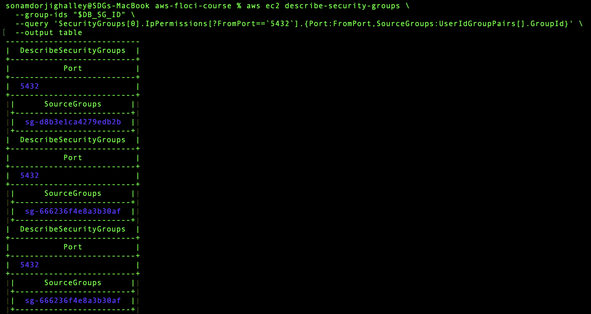

---

# 4.4 Network ACL Design

A NACL change would be required for campus HTTPS traffic because the existing private NACL does not explicitly permit inbound TCP 443 from `10.10.0.0/16`.

The following additional rules would be appropriate.

### Inbound Campus HTTPS

```text
Rule number: 120
Direction: Inbound
Protocol: TCP
Port: 443
Source: 10.10.0.0/16
Action: ALLOW
```

### Justification

This rule permits staff on the campus network to initiate HTTPS connections to the exam-results service.

### Outbound Campus Return Traffic

```text
Rule number: 120
Direction: Outbound
Protocol: TCP
Ports: 1024-65535
Destination: 10.10.0.0/16
Action: ALLOW
```

### Justification

Network ACLs are stateless. Therefore, HTTPS responses from the exam service must explicitly be allowed back to the clients' ephemeral ports.

The existing NACL already permits outbound HTTPS to `0.0.0.0/0` and inbound ephemeral return traffic, which supports outbound software-update connections.

The existing private-tier rule permitting TCP destination ports `1024-65535` to the VPC also includes PostgreSQL destination port `5432`, so a separate outbound PostgreSQL NACL rule is not required by the current rule set.

Only the security-group modifications were implemented in this exercise. The NACL modifications remain part of the proposed design.

---

# 4.5 NAT Gateway Availability and Cost

The existing NAT Gateway is located in:

```text
usms-public-subnet-a
us-east-1a
```

The private subnet in AZ b currently relies on that NAT Gateway for outbound connectivity.

If Availability Zone a became unavailable, a service operating in `usms-private-subnet-b` could remain operational but lose its outbound internet path because its NAT Gateway dependency is located in AZ a.

For a production system, I would deploy a second NAT Gateway in AZ b.

The design would use:

```text
Private Subnet A
    |
Private Route Table A
    |
NAT Gateway A
    |
Availability Zone A
```

and:

```text
Private Subnet B
    |
Private Route Table B
    |
NAT Gateway B
    |
Availability Zone B
```

This removes the NAT Gateway in AZ a as a single point of failure for resources running in AZ b.

### Approximate Cost

AWS lists a NAT Gateway rate of approximately:

```text
USD $0.045 per hour
```

plus approximately:

```text
USD $0.045 per GB processed
```

for the US East pricing example.

Using approximately 730 hours in a month:

```text
One NAT Gateway:

$0.045 × 730
= approximately $32.85 per month
```

For two NAT Gateways:

```text
$0.045 × 730 × 2
= approximately $65.70 per month
```

Therefore, adding a second NAT Gateway would add approximately:

```text
$32.85 per month
```

in NAT Gateway hourly charges before data-processing, public IPv4 and applicable data-transfer charges.

The increased cost would be justified for a production exam-results system if high availability is required.

### Source

Amazon Web Services (AWS), **Amazon VPC Pricing – NAT Gateway Pricing**, accessed August 2026.

---

# 4.6 Removal of usms-public-subnet-c

`usms-public-subnet-c` was created only as a practice resource in Exercise 1.

It is not required by later labs and should therefore be removed.

## Danger Note

**What will be deleted:**  
`usms-public-subnet-c` and its association with `usms-public-rt`.

**What depends on it:**  
Nothing should depend on this subnet because it was created only as an Exercise 1 practice resource.

**Reversible?**  
Yes. The subnet can be recreated using CIDR `10.0.5.0/24` in `us-east-1c` and associated with `usms-public-rt`.

**Effect on later labs:**  
None. The subnet is not stored in `configs/lab-02.env` and later practicals do not depend on it.

---

## Correct Deletion Order

The route-table association was identified first.

```bash
PUBLIC_ASSOC_C_ID=$(aws ec2 describe-route-tables \
  --filters "Name=association.subnet-id,Values=$PUBLIC_SUBNET_C_ID" \
  --query 'RouteTables[0].Associations[?SubnetId==`'"$PUBLIC_SUBNET_C_ID"'`].RouteTableAssociationId | [0]' \
  --output text)

echo "PUBLIC_ASSOC_C_ID=$PUBLIC_ASSOC_C_ID"
```

## Output

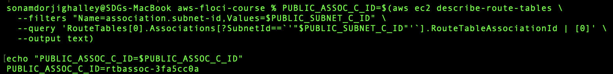

The route-table association was removed.

```bash
aws ec2 disassociate-route-table \
  --association-id "$PUBLIC_ASSOC_C_ID"
```

The subnet was then deleted.

```bash
aws ec2 delete-subnet \
  --subnet-id "$PUBLIC_SUBNET_C_ID"
```

The deletion was verified:

```bash
aws ec2 describe-subnets \
  --filters "Name=tag:Name,Values=usms-public-subnet-c" \
  --query 'Subnets[].SubnetId' \
  --output text
```

## Output

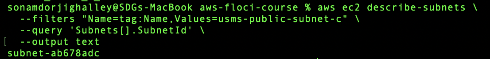

---

## Exercise 4 Result

A network design was developed for the proposed USMS exam-results service.

The service was placed conceptually in the private tier, HTTPS access was restricted to the university campus network, database access was controlled through a security-group reference and outbound patching was retained through the NAT architecture.

The high-availability and cost implications of adding a second NAT Gateway were also evaluated.

The temporary `usms-public-subnet-c` resource from Exercise 1 was removed after it was no longer required.

---

# Exercise 5 – Integration: Complete the Second Availability Zone

## Objective

The objective of this exercise was to complete the private tier across two Availability Zones by creating:

```text
usms-private-subnet-b
```

with:

```text
CIDR: 10.0.4.0/24
AZ: us-east-1b
```

The subnet was required because later practicals, particularly Amazon RDS, require private subnets across at least two Availability Zones.

The subnet had to:

- be created while using `usms-developer-role`;
- use CIDR `10.0.4.0/24`;
- be located in `us-east-1b`;
- be associated with `usms-private-rt`;
- use `usms-private-nacl`;
- appear in `configs/lab-02.env`; and
- pass final Lab 02 verification.

---

## Load the Environment

```bash
cd ~/aws-floci-course

source configs/course.env
source configs/lab-01.env
source configs/lab-02.env

VPC_ID="$USMS_VPC_ID"
PRIVATE_RT_ID="$USMS_PRIVATE_RT"
PRIVATE_NACL_ID="$USMS_PRIVATE_NACL"
```

---

## Assume usms-developer-role

The role ARN was created:

```bash
ROLE_ARN="arn:aws:iam::${USMS_ACCOUNT_ID}:role/${USMS_ROLE_DEVELOPER}"
```

The developer role was assumed:

```bash
aws sts assume-role \
  --role-arn "$ROLE_ARN" \
  --role-session-name "lab02-private-b-build" \
  --profile usms-dev \
  > outputs/lab-02-private-b-assumed-role.json
```

The temporary credential file was protected:

```bash
chmod 600 outputs/lab-02-private-b-assumed-role.json
```

The temporary credentials were loaded:

```bash
export AWS_ACCESS_KEY_ID=$(jq -r '.Credentials.AccessKeyId' outputs/lab-02-private-b-assumed-role.json)

export AWS_SECRET_ACCESS_KEY=$(jq -r '.Credentials.SecretAccessKey' outputs/lab-02-private-b-assumed-role.json)

export AWS_SESSION_TOKEN=$(jq -r '.Credentials.SessionToken' outputs/lab-02-private-b-assumed-role.json)
```

The caller identity was checked before creating the subnet.

```bash
aws sts get-caller-identity
```

## Output

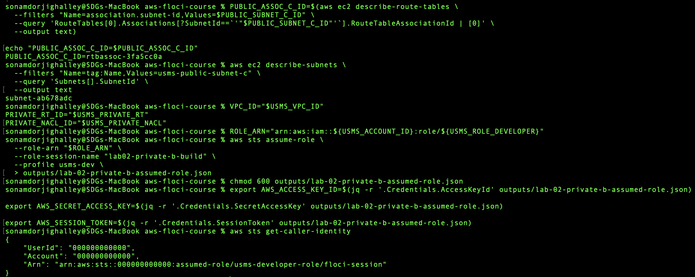

The ARN contained:

```text
assumed-role/usms-developer-role/lab02-private-b-build
```

This confirmed that the subnet was being created using the required developer role.

---

## Create usms-private-subnet-b

```bash
PRIVATE_SUBNET_B_ID=$(aws ec2 create-subnet \
  --vpc-id "$VPC_ID" \
  --cidr-block 10.0.4.0/24 \
  --availability-zone "${AWS_REGION_COURSE}b" \
  --tag-specifications 'ResourceType=subnet,Tags=[{Key=Name,Value=usms-private-subnet-b},{Key=Project,Value=USMS},{Key=Tier,Value=private},{Key=AZ,Value=b}]' \
  --query 'Subnet.SubnetId' \
  --output text)

echo "PRIVATE_SUBNET_B_ID=$PRIVATE_SUBNET_B_ID"
```

## Output

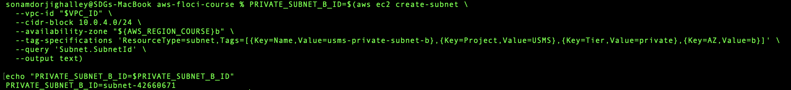


## Associate with the Private Route Table

```bash
PRIVATE_ASSOC_B_ID=$(aws ec2 associate-route-table \
  --route-table-id "$PRIVATE_RT_ID" \
  --subnet-id "$PRIVATE_SUBNET_B_ID" \
  --query 'AssociationId' \
  --output text)

echo "PRIVATE_ASSOC_B_ID=$PRIVATE_ASSOC_B_ID"
```

## Output

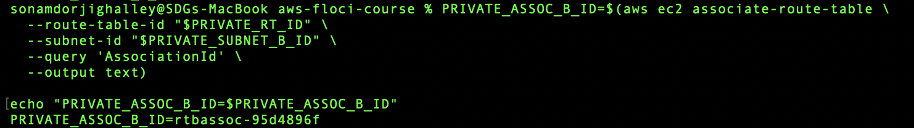

---

## Find the Default NACL Association

The newly created subnet initially used the VPC's default NACL.

Its NACL association was found using:

```bash
NACL_ASSOC_B_ID=$(aws ec2 describe-network-acls \
  --filters "Name=association.subnet-id,Values=$PRIVATE_SUBNET_B_ID" \
  --query 'NetworkAcls[0].Associations[0].NetworkAclAssociationId' \
  --output text)

echo "NACL_ASSOC_B_ID=$NACL_ASSOC_B_ID"
```

## Output

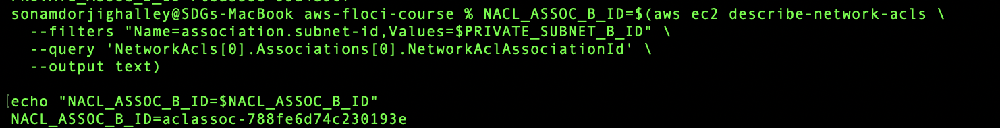

---

## Apply usms-private-nacl

The existing NACL association was replaced:

```bash
aws ec2 replace-network-acl-association \
  --association-id "$NACL_ASSOC_B_ID" \
  --network-acl-id "$PRIVATE_NACL_ID" \
  --query 'NewAssociationId' \
  --output text
```

## Output

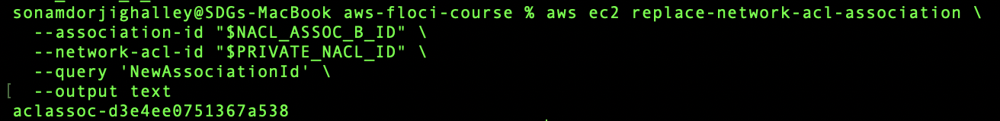

---

## Restore the Normal Identity

The temporary assumed-role credentials were removed immediately after creating the subnet.

```bash
unset AWS_ACCESS_KEY_ID AWS_SECRET_ACCESS_KEY AWS_SESSION_TOKEN
```

The normal identity was verified.

```bash
./scripts/utilities/whoami.sh
```

## Output

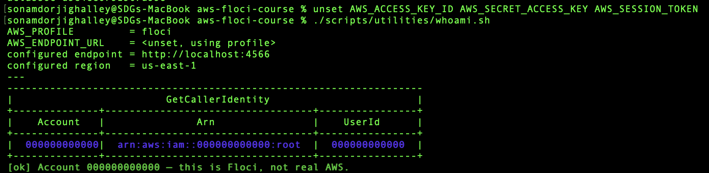

The normal identity was restored immediately because temporary environment credentials override named AWS CLI profiles and eventually expire. Leaving them active could cause later commands to execute using an unintended or expired identity.

---

# Verification

## Verify Private Subnet B

```bash
aws ec2 describe-subnets \
  --subnet-ids "$PRIVATE_SUBNET_B_ID" \
  --query 'Subnets[0].{Name:Tags[?Key==`Name`]|[0].Value,CIDR:CidrBlock,AZ:AvailabilityZone,PublicIP:MapPublicIpOnLaunch,State:State}' \
  --output table
```

## Output

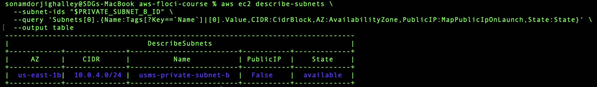

The expected configuration was:

```text
Name       = usms-private-subnet-b
CIDR       = 10.0.4.0/24
AZ         = us-east-1b
PublicIP   = False
State      = available
```

---

## Verify the Route Table

```bash
aws ec2 describe-route-tables \
  --filters "Name=association.subnet-id,Values=$PRIVATE_SUBNET_B_ID" \
  --query 'RouteTables[0].RouteTableId' \
  --output text
```

## Output

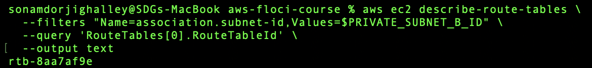


## Verify the Network ACL

```bash
aws ec2 describe-network-acls \
  --filters "Name=association.subnet-id,Values=$PRIVATE_SUBNET_B_ID" \
  --query 'NetworkAcls[0].{Id:NetworkAclId,Name:Tags[?Key==`Name`]|[0].Value,Default:IsDefault}' \
  --output table
```

## Output

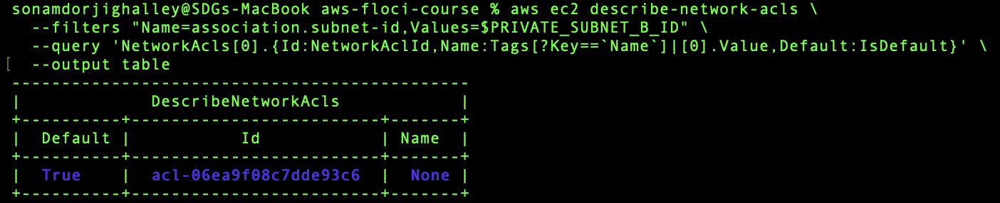


---

# Regenerate configs/lab-02.env

After `usms-private-subnet-b` was created, the Lab 02 environment file was regenerated using the procedure from Step 24 of the main practical.

The file was checked for empty values:

```bash
grep -n 'export .*=$\|None' configs/lab-02.env \
  || echo "all values populated"
```

## Output

```text
all values populated
```

The environment file was loaded:

```bash
source configs/lab-02.env
```

The new private subnet variable was checked:

```bash
echo "USMS_PRIVATE_SUBNET_B=$USMS_PRIVATE_SUBNET_B"
```

## Output

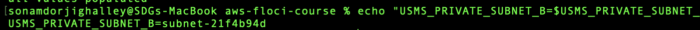

The total number of exported values was checked:

```bash
grep -c '^export' configs/lab-02.env
```

## Output

```text
17
```

---

# Verify the Final Subnet Architecture

The complete subnet inventory was retrieved:

```bash
aws ec2 describe-subnets \
  --filters "Name=vpc-id,Values=$USMS_VPC_ID" \
  --query 'sort_by(Subnets,&CidrBlock)[].{Name:Tags[?Key==`Name`]|[0].Value,CIDR:CidrBlock,AZ:AvailabilityZone,PublicIP:MapPublicIpOnLaunch}' \
  --output table
```

## Output

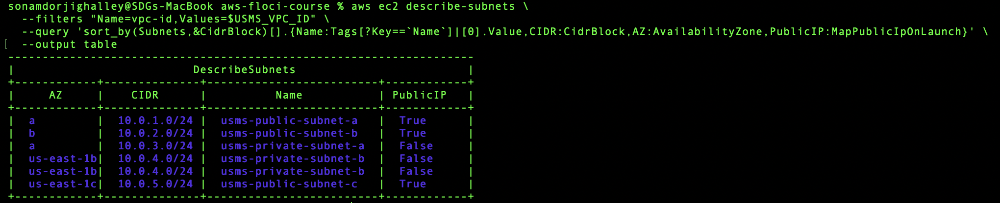


---

# Final Lab Verification

The Lab 02 verification script was run again.

```bash
./scripts/utilities/verify-lab-02.sh
```

## Output

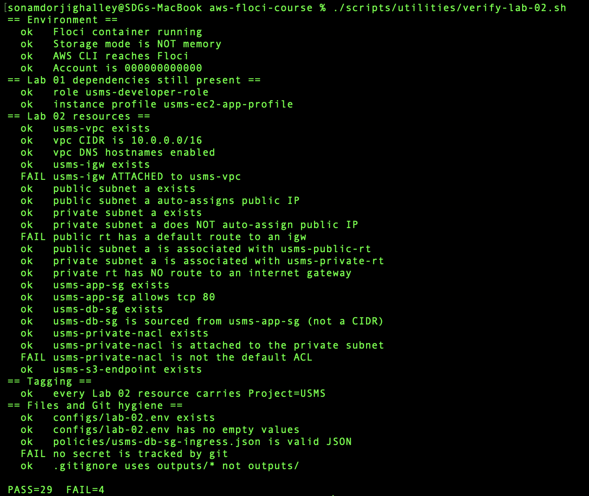


---

## Result

`usms-private-subnet-b` was successfully created in `us-east-1b` using the required assumed developer role.

The subnet:

- uses CIDR `10.0.4.0/24`;
- does not automatically assign public IPv4 addresses;
- is associated with `usms-private-rt`;
- is protected by `usms-private-nacl`;
- is recorded in `configs/lab-02.env`; and
- is available to subsequent EC2 and RDS practicals.

The private network therefore spans at least two Availability Zones as required.

---

# Overall Exercise Conclusion

The five independent exercises extended and validated the network architecture created during Lab 02.

Exercise 1 demonstrated the creation of an additional public subnet and the reuse of an existing public route table.

Exercise 2 improved administrative security by introducing a bastion security group and replacing a broad CIDR-based SSH rule with a security-group reference.

Exercise 3 demonstrated how subnet classification can be derived automatically from routing information rather than from names or tags.

Exercise 4 applied the networking concepts to a realistic exam-results service, including campus-only connectivity, private subnet placement, database access, NACL considerations, NAT Gateway availability and cost.

Exercise 5 completed the second Availability Zone for the private tier and prepared the VPC for later EC2 and Amazon RDS practicals.

Together, these exercises reinforced the concepts of least privilege, route-based subnet classification, stateful and stateless security, security-group referencing, high availability and reusable AWS CLI automation.